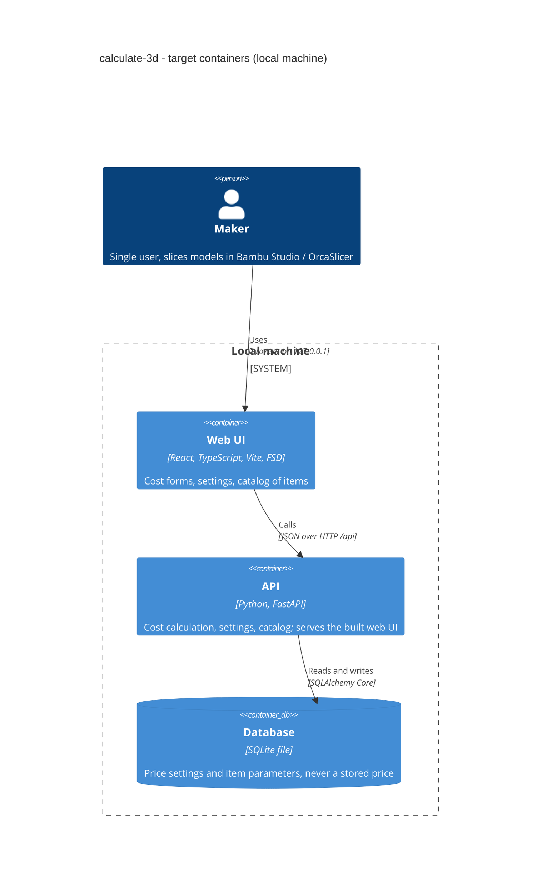

# Architecture map — calculate-3d

> **Foundation (target baseline)**, not a scan: the repo has no code yet. Produced by
> `map-architecture` in greenfield mode from the user's choices on 2026-10-27, and read by
> write-prd / architecture-design / generate-data-model / implement-tasks. After the scaffold lands,
> refresh with `/sdlc:map-architecture` so this map describes real `file:line` anchors.
>
> Product context: `docs/idea-brief.md` — a **local, single-user** tool that computes the cost price
> of a 3D print (= the minimum donation in UAH). Foundational decisions: `docs/adr/0001`–`0004`.

## Stack

- **Language / runtime:** Python **3.14** (pinned via `backend/.python-version`, installed by `uv`;
  system Python 3.9 is NOT used) · Node **24 LTS+** for the web (local: 26.x).
- **Backend:** FastAPI + Pydantic v2 (+ `pydantic-settings` for config) · Uvicorn.
- **Persistence:** SQLite (single file) · SQLAlchemy 2 **Core** (no ORM) · Alembic migrations.
- **Frontend:** React + TypeScript + Vite · Feature-Sliced Design · Tailwind CSS + shadcn/ui ·
  TanStack Query · types generated from the backend OpenAPI by `openapi-typescript`.
- **Auth:** none — the app binds to `127.0.0.1` only (ADR 0004).
- **Build / test / lint** (the commands `implement-tasks` detects — all via the root `Makefile`):

  | Target | Does |
  |---|---|
  | `make dev` | `uvicorn --reload` on :8000 + `vite` on :5173 (Vite proxies `/api` → :8000) |
  | `make run` | builds `web/dist`, FastAPI serves it + the API on `127.0.0.1:8000` (one process) |
  | `make api-check` | `uv run ruff check` · `ruff format --check` · `mypy --strict` · `pytest` |
  | `make web-check` | `npm run lint` (ESLint + Steiger FSD linter) · `tsc --noEmit` · `vitest run` · `vite build` |
  | `make check` | `api-check` + `web-check` (exactly what CI runs) |
  | `make migrate` / `make migrate-down` | `alembic upgrade head` / `alembic downgrade -1` |
  | `make api-types` | dump FastAPI OpenAPI → `web/src/shared/api/schema.d.ts` |

## C4 — target baseline



## Module inventory

Backend modules live in `backend/src/calculate3d/modules/<module>/`; each is a vertical slice with
simple layers (ADR 0002). The scaffold creates **only `health`** as the baseline module; domain
modules (likely pricing settings, catalog, costing) are designed per feature by
`architecture-design` — not pre-created here.

| Module | Path | Layers | Wired at | Responsibility |
|---|---|---|---|---|
| core | `backend/src/calculate3d/core/` | config · db · errors · ids | `backend/src/calculate3d/main.py` (`create_app`) | Settings, engine/connection, error envelope, UUIDv7 |
| health | `backend/src/calculate3d/modules/health/` | router · schemas · service · repo · tables | `main.py` → `app.include_router(...)` | `GET /api/health` → `{"status":"ok","db":"ok"}` (pings SQLite) |
| web app | `web/src/` | FSD: app · pages · widgets · features · entities · shared | `web/src/app/` (providers, router) | UI shell + a Home page showing API health |

### Target folder layout

```
backend/
  pyproject.toml  uv.lock  .python-version  alembic.ini
  src/calculate3d/
    main.py                  # create_app(): routers, error handlers, static web/dist mount
    core/                    # config.py, db.py, errors.py, ids.py
    modules/<module>/
      router.py              # FastAPI APIRouter — HTTP only, no business logic
      schemas.py             # Pydantic request/response models
      service.py             # business logic (pure functions/classes, no FastAPI imports)
      repo.py                # SQL via SQLAlchemy Core; returns plain dataclasses/dicts
      tables.py              # sqlalchemy.Table definitions (shared MetaData)
  migrations/                # Alembic env.py + versions/
  tests/unit/  tests/integration/  conftest.py
web/
  package.json  vite.config.ts  tsconfig.json  components.json (shadcn)
  src/app/  pages/  widgets/  features/  entities/
  src/shared/ui/  shared/api/  shared/lib/  shared/config/
Makefile
.github/workflows/ci.yml
CLAUDE.md                    # conventions summary for agents (from this map)
```

## Conventions (the rules a new feature must match)

> Greenfield: anchors point at the files the scaffold will create; refresh the map after scaffold
> to replace them with real `file:line` citations.

- **Module wiring / registration:** each module exposes `router = APIRouter(prefix="/api/<module>")`
  in `router.py`; `create_app()` in `backend/src/calculate3d/main.py` includes it. Modules call each
  other only through the other module's `service.py` (never its `repo.py`/`tables.py`).
- **Layering (ADR 0002):** `router → service → repo`. Router: HTTP parsing + status codes only.
  Service: business rules, no FastAPI / SQL imports, unit-testable. Repo: SQLAlchemy Core statements,
  takes a `Connection`. Dependencies injected with FastAPI `Depends`; the connection comes from
  `ConnectionDep` (per request, transaction via `engine.begin()`, `scope="function"` so it commits
  before the response is sent). Health-only exception: its repo pings an `Engine`, not the
  per-request `Connection`, so a dead DB yields `db: "down"` instead of failing in `get_connection`.
- **Error handling:** domain errors subclass `AppError(code, message, status)` in `core/errors.py`;
  one exception handler renders **RFC 9457 problem+json**
  `{"type","title","status","detail","code"}`; validation errors (422) use the same envelope.
- **IDs:** **UUIDv7** generated in the app (`core/ids.py`, stdlib `uuid.uuid7()` — Python 3.14+),
  stored as `TEXT` (canonical 36-char string). The DB never generates IDs (ADR 0003).
- **Money (ADR 0003):** stored as `INTEGER` **kopecks** (`*_kop` column suffix, e.g.
  `price_per_kg_kop`); computed with `decimal.Decimal`; the final cost / minimum donation is rounded
  **up** (`ROUND_CEILING`) to whole kopecks so it is never understated. API exposes kopecks as ints;
  the UI formats to `₴` with `Intl.NumberFormat('uk-UA')`. Never `float` for money.
- **Physical quantities:** grams as `INTEGER`/`REAL` `*_g`, durations as `INTEGER` seconds `*_s`,
  power as `INTEGER` watts `*_w`, rates as `*_per_hour_kop` — the unit lives in the column name.
- **Persistence / DB access:** SQLAlchemy 2 Core only (`select()/insert()/update()/delete()` on
  `Table` objects), no ORM sessions. "DB as dumb storage": no CHECK, no TRIGGER, no business
  defaults — validation lives in Pydantic/service. `created_at` (UTC ISO-8601 `TEXT`) audit column
  only; hard delete. SQLite pragmas on connect: `foreign_keys=ON`, `journal_mode=WAL`.
  DB file: `CALC3D_DATABASE_URL`, default `sqlite:///backend/var/calculate3d.db` (gitignored).
- **Migrations:** Alembic in `backend/migrations/`, file template
  `%%(year)d%%(month).2d%%(day).2d_%%(hour).2d%%(minute).2d_%%(slug)s` (**timestamped**).
  **SQL-first:** `upgrade()`/`downgrade()` contain `op.execute("""<SQL>""")` — no autogenerate.
  Promotion of `generate-data-model` staged pairs: `<NN>_*.up.sql` body → `upgrade()`, `.down.sql`
  body → `downgrade()`, copied verbatim into a fresh timestamped revision. Every migration must
  `upgrade → downgrade → upgrade` cleanly (tested).
- **Tests:** pytest. `tests/unit/` — services/pure logic, no I/O. `tests/integration/` — through
  FastAPI `TestClient` against a **real temporary SQLite file** migrated with Alembic per session
  (fixture in `tests/conftest.py`). Test names `test_<behaviour>`. Web: Vitest + Testing Library,
  `*.test.tsx` next to the component.
- **Lint / types:** ruff (lint + format, line length 100) and `mypy --strict` on `src/`; ESLint +
  Prettier + **Steiger** (FSD import-rule linter) + `tsc --strict` on `web/`.
- **Inter-module communication:** in-process direct calls to another module's `service.py`. No
  events/queues (single process, single user).
- **API shape:** JSON, `snake_case` fields, prefix `/api`, OpenAPI from FastAPI is the source of the
  frontend types (`make api-types`) — never hand-write API types on the web.
- **UI / styling:** Tailwind + shadcn/ui components copied into `web/src/shared/ui/` — detail in
  §Frontend / UI foundation.
- **CI:** one GitHub Actions workflow `.github/workflows/ci.yml` running `make check` (uv + Node set
  up); no deploy job (local-only, ADR 0004).

## Datastores

| Store | Engine | Accessed via | Notes |
|---|---|---|---|
| App DB | SQLite 3 (file) | SQLAlchemy 2 Core in `modules/*/repo.py` | Single writer; WAL; file under `backend/var/` (gitignored). Back up = copy the file. |

## Frontend / UI foundation

- **Component library / design system:** shadcn/ui primitives generated into `web/src/shared/ui/`
  (owned code, not a runtime dependency) — `web/components.json`.
- **Design tokens:** CSS variables (`--background`, `--foreground`, `--primary`, `--radius`, …) in
  `web/src/app/styles/index.css`, mapped into Tailwind theme; light + dark.
- **Styling approach:** **Tailwind CSS only** (utility classes + `cn()` helper in
  `web/src/shared/lib/cn.ts`). No CSS-in-JS, no second styling system.
- **Shared primitives (scaffold set):** Button, Input, Label, Card, Table — `web/src/shared/ui/`.
  Add more with `npx shadcn add <component>`, never hand-roll an equivalent.
- **State / data-fetching:** TanStack Query (`QueryClientProvider` in `web/src/app/providers/`);
  typed client in `web/src/shared/api/` built on `openapi-typescript` types + `openapi-fetch`.
  No global client-state store until a feature needs one.
- **FSD rules:** layers import only downward (`app → pages → widgets → features → entities →
  shared`); each slice exposes a public `index.ts`; enforced by Steiger in `make web-check`.
- **Closest UI precedent:** the scaffold's Home page `web/src/pages/home/` (Card showing
  `/api/health` via a TanStack Query hook in `web/src/entities/health/`) — new screens follow it.
- **Locale:** UI copy in Ukrainian; money via `Intl.NumberFormat('uk-UA', {style:'currency', currency:'UAH'})`.

## Where things live / closest precedents

- A new backend capability → new `backend/src/calculate3d/modules/<module>/` with
  `router/schemas/service/repo/tables`, wired in `main.py`, modelled on `modules/health/`.
- A new table → staged SQL from `generate-data-model`, promoted into an Alembic revision in
  `backend/migrations/versions/` (see Migrations convention).
- Cost formula / pure calculation → `service.py` (or a `domain.py` in that module if it grows),
  covered by unit tests with `Decimal` fixtures.
- Slicer-file import (brief stage 2) → a parser in the owning module (e.g. `importers/`), kept out
  of the router; manual input stays the fallback path.
- A new screen / UI component → `web/src/pages/<page>/` composing `features/` + `entities/` +
  `shared/ui` primitives, modelled on `web/src/pages/home/`.

## Constraints & known tech-debt

- **Local-only, no auth** (ADR 0004): the server must bind to `127.0.0.1`; exposing it on a network
  or adding deploy requires revisiting ADR 0004 (Google OAuth was the parked option).
- **Single user, single process:** SQLite's single-writer model is fine; do not introduce
  background workers or multi-process servers without revisiting ADR 0003.
- **Catalog stores parameters, never a final price** (brief §10 TOP risk) — prices are always
  recomputed from current settings.
- **No base-tpl template:** the skeleton is built by `implement-tasks _scaffold`, not copied; there
  is no Docker / Prometheus / deploy battery by design.
- Python 3.14 must be provided by `uv`; the system interpreter (3.9) is too old.

## Reconciliation with the authored architecture doc

No authored architecture doc exists (no `docs/architecture.md`, `ARCHITECTURE.md` or root
`CLAUDE.md`); this map is the reference. Root `CLAUDE.md` will be generated by scaffold task S7
from this map.
