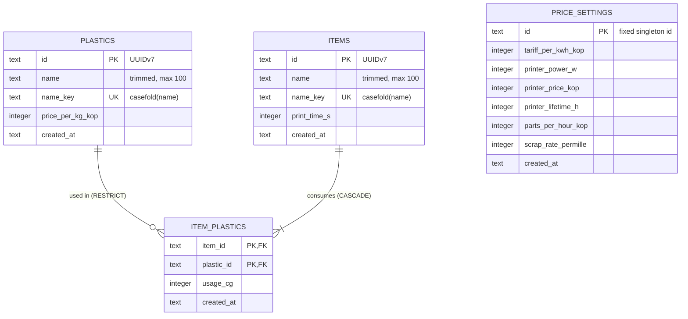

# Data model — cost-calculator

<!-- Generated by generate-data-model. Migrations are STAGED under
docs/features/cost-calculator/migrations/ (NOT the live backend/migrations/versions/ tree);
implement-tasks promotes them. -->

> **Inputs:** [PRD](PRD.md) §4–§5 · [SAD](sad.md) §5, §6, §8 · ADR [0003](adr/0003-recompute-catalog-prices-on-every-read.md), [0004](adr/0004-exchange-quantities-as-scaled-integers.md), [0005](adr/0005-split-feature-into-pricing-costing-catalog-modules.md), [0006](adr/0006-enforce-name-uniqueness-via-casefolded-name-key.md) · project ADR [0003](../../adr/0003-store-data-in-sqlite-via-sqlalchemy-core-and-alembic.md) (SQLite, IDs, money).
> **Dialect:** SQLite 3 (`foreign_keys=ON`, WAL). Course defaults are applied in their SQLite form — see `.claude/rules/migrations.md` § Repo adaptation.

Чотири таблиці у двох модулях. `pricing` володіє `plastics` і `price_settings`, `catalog` володіє `items` та `item_plastics`. Модуль `costing` нічого не зберігає (ADR 0005). Жодна таблиця не містить ціни виробу чи мінімального донату: вони щоразу перераховуються (ADR 0003, інваріант CONTEXT).

## ER diagram

`ITEMS ||--|{ ITEM_PLASTICS`: виріб має хоча б один рядок витрати (AC-07, AC-10). Це правило тримає `catalog.service`, а не БД.

## Entities

Спільне для всіх таблиць (дефолти курсу в SQLite-формі):
- PK — UUIDv7 з `core/ids.py::new_id()`, `TEXT` 36 символів; БД ID не генерує.
- `created_at TEXT NOT NULL DEFAULT (strftime('%Y-%m-%dT%H:%M:%fZ', 'now'))` — UTC ISO-8601. **`updated_at` немає ніде:** усі сутності змінні, але PRD не вимагає знати, коли щось змінилося, а історія цін — свідомий non-goal (PRD §3).
- Hard delete, без `deleted_at`. Без `CHECK` / `TRIGGER` / бізнес-`DEFAULT`: діапазони (> 0, 0–1000 ‰, цілі години тощо) перевіряють Pydantic і сервіс (ADR 0004).
- Рядки — `TEXT` (рішення автора 2026-10-28, конвенція репо). Межу довжини тримає Pydantic, `max_length=100` для назв.

### Aggregate `pricing` → `plastics`

| Column | Type | Constraints | Notes |
|---|---|---|---|
| `id` | TEXT | PK, app-generated (UUIDv7) | |
| `name` | TEXT | NOT NULL | як ввів автор, після trim; 1–100 символів (Pydantic). AC-01, AC-02 |
| `name_key` | TEXT | NOT NULL, UNIQUE (`uq_plastics_name_key`) | `core/text.name_key(name)` = `casefold()`; оновлюється разом із `name` (ADR 0006) |
| `price_per_kg_kop` | INTEGER | NOT NULL | ціна за кг у копійках, > 0 (Pydantic); 650 ₴ → `65000`. AC-01, AC-02 |
| `created_at` | TEXT | NOT NULL DEFAULT (UTC ISO-8601) | |

**Aggregate root:** root (модуль `pricing`).
**Access patterns:** список усіх пластиків для налаштувань і для `costing` (читає всі, бо їх ≤ 50) → повний скан, індекс не потрібен. Пошук зайнятої назви → `uq_plastics_name_key`.
**Constraints:** UNIQUE `name_key`. На `plastics` посилається `item_plastics.plastic_id` з ON DELETE RESTRICT.

### Aggregate `pricing` → `price_settings` (singleton)

| Column | Type | Constraints | Notes |
|---|---|---|---|
| `id` | TEXT | PK | **завжди** константа `00000000-0000-7000-8000-000000000001` у `pricing` (не seed) |
| `tariff_per_kwh_kop` | INTEGER | NOT NULL | тариф, коп за кВт·год, ≥ 0; 4,32 ₴ → `432`. AC-04, AC-05 |
| `printer_power_w` | INTEGER | NOT NULL | середня потужність, цілі Вт, ≥ 0; `150` |
| `printer_price_kop` | INTEGER | NOT NULL | ціна принтера, коп, ≥ 0; 30 000 ₴ → `3000000` |
| `printer_lifetime_h` | INTEGER | NOT NULL | термін служби, цілі години друку, > 0; `5000`. Новий суфікс `_h`: див. «Відхилення від конвенцій» |
| `parts_per_hour_kop` | INTEGER | NOT NULL | деталі, коп за годину друку, ≥ 0; 1,00 ₴ → `100` |
| `scrap_rate_permille` | INTEGER | NOT NULL | брак у десятих відсотка, 0–1000; 10 % → `100` (ADR 0004) |
| `created_at` | TEXT | NOT NULL DEFAULT (UTC ISO-8601) | момент **першого** збереження; upsert його не перезаписує |

**Aggregate root:** root (модуль `pricing`).
**Semantics:** немає рядка — налаштування «не задано», і `costing` повертає `costing.settings_missing` з `missing` (AC-09). Збереження: `INSERT … ON CONFLICT (id) DO UPDATE SET <усі 6 полів>` в одній транзакції запиту (AC-04, AC-05). PK на фіксованому id не дає з'явитися другому рядку без `CHECK`, а `NOT NULL` на всіх полях не дає «очистити» налаштування назад.
**Access patterns:** читання за PK (єдиний рядок) → PK.
**Constraints:** PK.

### Aggregate `catalog` → `items`

| Column | Type | Constraints | Notes |
|---|---|---|---|
| `id` | TEXT | PK, app-generated (UUIDv7) | `/catalog/:itemId` (ADR 0001 фічі) |
| `name` | TEXT | NOT NULL | після trim, 1–100 символів. AC-10, AC-11, AC-14b |
| `name_key` | TEXT | NOT NULL, UNIQUE (`uq_items_name_key`) | casefold (ADR 0006) |
| `print_time_s` | INTEGER | NOT NULL | час друку в секундах, > 0. UI вводить цілі год + хв, тож значення кратне 60 (AC-07); 3 год 30 хв → `12600` |
| `created_at` | TEXT | NOT NULL DEFAULT (UTC ISO-8601) | |

**Aggregate root:** root (модуль `catalog`), володіє `item_plastics`.
**Access patterns:** каталог читає **всі** вироби одним пакетом, а фільтр і сортування робить у Python (ADR 0003, ADR 0006) → повний скан, без індексу на `name`. Відкриття виробу → PK. Зайнятість назви → `uq_items_name_key`.
**Constraints:** UNIQUE `name_key`.

### Aggregate `catalog` → `item_plastics` (child of `items`)

| Column | Type | Constraints | Notes |
|---|---|---|---|
| `item_id` | TEXT | NOT NULL, PK (1), FK → `items(id)` ON DELETE CASCADE | AC-15: виріб зникає разом із рядками |
| `plastic_id` | TEXT | NOT NULL, PK (2), FK → `plastics(id)` ON DELETE RESTRICT | AC-03: страховка під перевіркою `pricing.service` |
| `usage_cg` | INTEGER | NOT NULL | витрата в сотих грама, > 0; 120 г → `12000`; 12,34 г → `1234` (ADR 0004) |
| `created_at` | TEXT | NOT NULL DEFAULT (UTC ISO-8601) | при збереженні виробу рядки перезаписуються, тож це момент останнього збереження |

**Aggregate root:** `items`. Рядки пишуться лише разом із виробом: `DELETE … WHERE item_id = ?`, потім `INSERT` усіх рядків в одній транзакції (SAD §6 «Зберегти виріб», AC-14b, AC-14c).
**Access patterns:** рядки виробу → PK (ліва колонка `item_id`). Назви виробів, що використовують пластик → `idx_item_plastics_plastic_id`. Каталог читає всі рядки пакетом → повний скан.
**Constraints:** складений PK `(item_id, plastic_id)` не дає вказати пластик двічі в одному виробі (AC-07; UI пояснює про об'єднання рядків). Перехресний модульний FK `catalog → pricing` зафіксовано в SAD §5 і ADR 0005: на рівні коду `catalog` не читає `plastics` напряму, а FK лише гарантує цілісність.

## Indexes

| Index | Columns | Query it serves |
|---|---|---|
| `uq_plastics_name_key` (UNIQUE) | `plastics(name_key)` | SAD §6 «Додати або змінити пластик»: «шукає інший пластик з тим самим ключем назви» + гарантія унікальності (AC-02, ADR 0006) |
| `uq_items_name_key` (UNIQUE) | `items(name_key)` | SAD §6 «Зберегти виріб у каталог»: «шукає інший виріб з тим самим ключем назви» + гарантія (AC-11, AC-14c) |
| PK `item_plastics(item_id, plastic_id)` | `item_id, plastic_id` | SAD §6 «Відкрити виріб»: «читає … рядки витрати пластиків за ідентифікатором»; «Зберегти виріб»: заміна рядків за `item_id`; FK-індекс для CASCADE (AC-07, AC-14, AC-15) |
| `idx_item_plastics_plastic_id` | `item_plastics(plastic_id)` | SAD §6 «Critical flow 3»: «назви виробів із цим пластиком» (AC-03); FK-індекс для перевірки RESTRICT під час `DELETE FROM plastics` |

Відкинуті кандидати: індекс на `items.name` чи `plastics.name` (ADR 0006: SQL-сортування не дає українського абеткового порядку, тому сортування в Python) і на `created_at` (жоден запит за ним не фільтрує й не сортує). Обидва запити з таблиці перевірено `EXPLAIN QUERY PLAN` на SQLite 3.54: `SEARCH … USING INDEX`.

## Staged migrations

| Order | Up / Down | Module |
|---|---|---|
| 1 | [`20261028120000_create_plastics`](migrations/20261028120000_create_plastics.up.sql) · [down](migrations/20261028120000_create_plastics.down.sql) | pricing |
| 2 | [`20261028120001_create_price_settings`](migrations/20261028120001_create_price_settings.up.sql) · [down](migrations/20261028120001_create_price_settings.down.sql) | pricing |
| 3 | [`20261028120002_create_items`](migrations/20261028120002_create_items.up.sql) · [down](migrations/20261028120002_create_items.down.sql) | catalog |
| 4 | [`20261028120003_create_item_plastics`](migrations/20261028120003_create_item_plastics.up.sql) · [down](migrations/20261028120003_create_item_plastics.down.sql) | catalog |

`item_plastics` посилається на `plastics` та `items`, тому порядок 1 → 4 обов'язковий (down — у зворотному). **Під час promote:** кожна пара стає Alembic-ревізією в `backend/migrations/versions/` з `down_revision` у тому самому ланцюжку, а **кожне SQL-твердження — окремим `op.execute("""…""")`**, бо sqlite3 виконує лише одне твердження за виклик.

**Seeds:** немає. Bootstrap-даних фіча не потребує, а `price_settings` навмисно порожня до першого збереження (AC-09). Lookup-таблиць немає.

## Test fixtures

Фабрики **не** в міграціях. Створює їх `implement-tasks` разом із `tables.py`/`repo.py`, бо зараз модулів ще немає і код фабрик не пройшов би `mypy --strict`. Форма для репо — Python-хелпери в `backend/tests/factories.py`, які пишуть через SQLAlchemy Core у `Connection` з фікстури `engine`:

- `make_plastic(conn, *, name="PETG чорний", price_per_kg_kop=65000) -> str` — пластик, повертає `id`; `name_key` рахує `core/text.name_key`.
- `make_price_settings(conn, **overrides) -> None` — singleton-рядок; дефолти — значення AC-04 (`432 / 150 / 3000000 / 5000 / 100 / 100`).
- `make_item(conn, *, name="Брелок-тризуб", print_time_s=12600, usage={plastic_id: 12000}) -> str` — виріб разом із рядками `item_plastics`.
- `seed_catalog_volume(conn, items=1000, plastics=50, seed=…)` — детерміновані дані для тестів латентності QG-2 (SAD §10).

PII guard: назви — товарні («PETG чорний», «Брелок-тризуб», `Item-<n>`). Людей, email і телефонів немає.

## Відхилення від конвенцій (див. також аудит)

- **`printer_lifetime_h`**: новий суфікс одиниці `_h` (цілі години). AC-05 забороняє дробовий термін служби, тож найменша допустима одиниця — година (принцип ADR 0004). Запис у секундах (`_s`) дав би 18 000 000 і хибне враження, що можна вводити точніше. Додати `_h` до списку суфіксів у `CLAUDE.md` разом із боргом про `_cg` і `_permille` (SAD §11).
- **`scrap_rate_permille`**, **`usage_cg`**: суфікси з ADR 0004.
