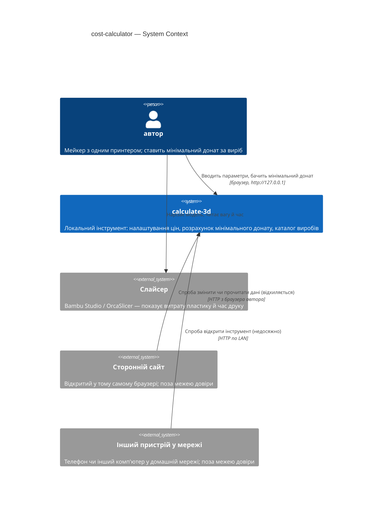
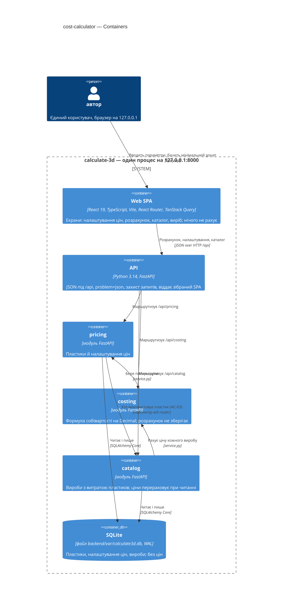
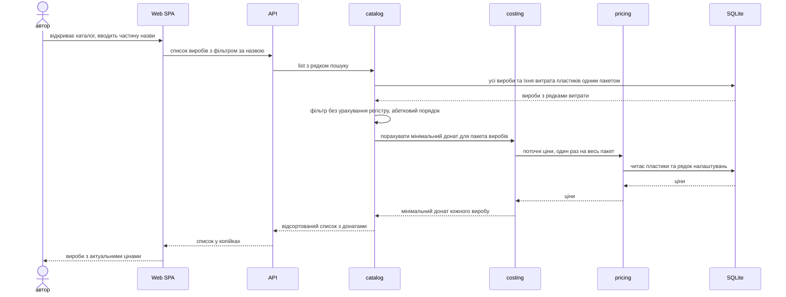
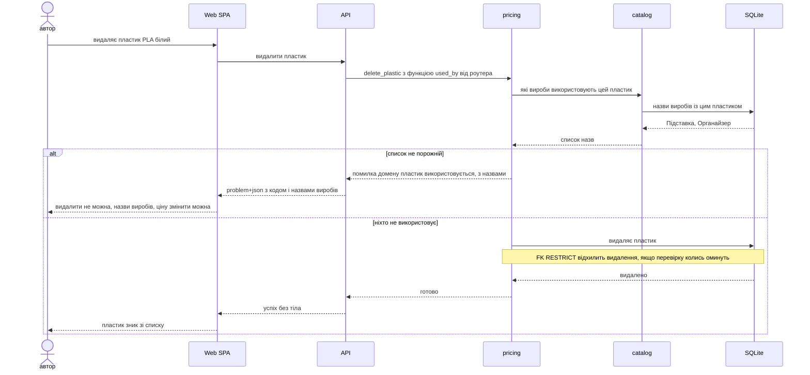

# Software Architecture Document — cost-calculator

<!-- Stages 04-05 → see sdlc/plugin/skills/architecture-design/SKILL.md -->
<!-- 12 Arc42 sections. Empty sections — <!-- N/A: <one-line reason> -->. -->
<!-- C4 Context (L1) lives inline in §3. C4 Container (L2) lives inline in §5. -->
<!-- §6 Runtime view seeds the primary flow(s) here; complete-sequence-diagrams (stage 06) then -->
<!--    fills §6 with every critical flow / §5 AC — no cap. -->
<!-- Numbers in §10 come VERBATIM from PRD §6 NFR — no inventing, no rounding. -->

## 1. Introduction and goals

**Intent.** Локальний інструмент для **автора**: з **витрати пластику** (по кожному пластику виробу) і часу друку, перенесених зі слайсера, та з поточних **налаштувань цін** він розраховує **мінімальний донат** із **розбивкою собівартості**. **Каталог** зберігає лише параметри **виробу** (не ціну) і щоразу перераховує мінімальний донат з актуальних налаштувань цін, тож повторюваний виріб не продається в мінус непомітно після подорожчання пластику чи тарифу (PRD §2). Цей SAD покриває етап 1 підходу C — ручне введення; імпорт файлу слайсера — окрема фіча (PRD §3).

**Top quality goals (1-liners; full scenarios in §10; порядок = пріоритет при конфлікті):**

1. **QG-1 Точність розрахунку** — 100 % збіг до копійки з еталонною таблицею; мінімальний донат ніколи не менший за собівартість.
2. **QG-2 Чуйність** — перерахунок мінімального донату p95 ≤ 300 мс; відкриття каталогу p95 ≤ 500 мс (1 000 виробів, 50 пластиків).
3. **QG-3 Доступ лише автору** — інструмент недоступний з інших пристроїв і не приймає змін та не віддає даних стороннім сайтам у браузері автора (AC-16, AC-16b).
4. **QG-4 Збереженість** — 100 % збережених змін доступні після перезапуску інструмента чи комп'ютера.

**Stakeholders.**

| Role | Interest | Sign-off owner? |
|---|---|---|
| автор | єдиний користувач (налаштування цін, розрахунок, каталог); водночас власник продукту, архітектор і розробник навчального проєкту | Yes |

<!-- Decision overrides (¶4) — populated by the Step-7 critic resolution loop, empty otherwise.       -->

## 2. Constraints

**Technical** (версії — з `backend/uv.lock` і `web/package.json` на 2026-10-28).
- Python **3.14** (через `uv`; системний 3.9 не використовується) · FastAPI **0.162** (Starlette 1.10) · Pydantic **2.14** + pydantic-settings 2.16 · Uvicorn 0.54.
- SQLite 3 — один файл, `journal_mode=WAL`, `foreign_keys=ON` на кожному з'єднанні · SQLAlchemy **2.1** Core (без ORM) · Alembic **1.20**, міграції SQL-first (ADR 0003).
- React **19** + TypeScript **5.9** + Vite **8** · Tailwind CSS **4** + shadcn/ui (`web/src/shared/ui/`) · TanStack Query **5** · `openapi-fetch` 0.17 + `openapi-typescript` 7 (типи вебу генеруються з OpenAPI бекенду).
- Модульний моноліт із простими шарами router → service → repo; модулі спілкуються лише через `service.py` іншого модуля (ADR 0002). Веб — Feature-Sliced Design, контроль імпортів — Steiger.
- Один процес, bind лише на `127.0.0.1`, без автентифікації (ADR 0004); без фонових воркерів і багатопроцесних серверів (ADR 0003).

**Organisational.**
- Одна людина: автор — водночас PM, архітектор і розробник.
- Бюджет 2–4 тижні без жорсткого дедлайну (idea-brief §4); навчальний проєкт, який проходить повний SDLC-пайплайн.
- Гейт якості перед кожним комітом і в CI — `make check` (`api-check` + `web-check` + `api-types-check`).

**Conventions.**
- Кореневий `CLAUDE.md` + `backend/CLAUDE.md` + `web/CLAUDE.md` — джерело конвенцій. `docs/architecture-map.md` описує стан до scaffold і застарів (див. §11).
- IDs — UUIDv7 із застосунку (`core/ids.py::new_id()`), `TEXT` 36 символів; БД ID не генерує.
- Гроші — `INTEGER` копійки з суфіксом `_kop`, обчислення в `decimal.Decimal`, мінімальний донат округлюється вгору (`ROUND_CEILING`); `float` для грошей заборонено. Одиниця виміру — в назві колонки (`*_g`, `*_s`, `*_w`, `*_per_hour_kop`).
- Помилки — `AppError(code, message, status)` → RFC 9457 `application/problem+json`; сервіси не кидають `HTTPException`.
- «БД як тупе сховище»: без CHECK/TRIGGER/бізнес-дефолтів; аудит лише `created_at`; hard delete.
- Каталог зберігає параметри, ніколи не готову ціну.

**Regulatory / external.**
- Персональних даних немає; класифікація даних — internal (PRD §6.1).
- Межа захисту — доступ лише з комп'ютера автора без входу в систему (ADR 0004); потреба в доступі з іншого пристрою — тригер перегляду ADR 0004.
- Abuse cases з PRD §6.1, обов'язкові до виконання: доступ з іншого пристрою в мережі (AC-16), запити сторонніх сайтів у браузері автора, зокрема DNS rebinding (AC-16b), назви, схожі на код чи розмітку (показуються як текст).
- Security review — Required (легкий), фокус: AC-16/AC-16b.

## 3. Context and scope

Автор нарізає модель у слайсері, переносить витрату кожного пластику та час друку в інструмент і отримує мінімальний донат із розбивкою собівартості; повторювані вироби зберігає в каталог, де ціна щоразу перераховується з поточних налаштувань цін (PRD §1). Інструмент — одна система на комп'ютері автора; інтеграцій із зовнішніми сервісами немає. Межа довіри (trust boundary) — сам комп'ютер автора: інші пристрої в домашній мережі та сторонні сайти, відкриті в тому самому браузері, лежать **поза** нею, і інструмент їм не відповідає (AC-16, AC-16b).

**External systems (in / out):**

| Actor or system | Type | Interaction |
|---|---|---|
| автор | Person | Веде налаштування цін, рахує мінімальний донат, веде каталог — через браузер на `127.0.0.1` |
| Слайсер (Bambu Studio / OrcaSlicer) | System (external) | Джерело витрати пластику й часу друку; автор переносить значення **вручну** — інтеграції немає (імпорт файлу — етап 2, PRD §3) |
| Сторонній сайт у браузері автора | System (external, hostile) | Може спробувати надіслати запит до інструмента від імені автора (CSRF) або через DNS rebinding; запит відхиляється (AC-16b) |
| Інший пристрій у домашній мережі | System (external, hostile) | Може спробувати відкрити інструмент; сервер слухає лише `127.0.0.1`, тож з мережі він недосяжний (AC-16) |

**C4 Context (L1):**



## 4. Solution strategy

**Target surface(s) (the first decision — what's being built):** `[backend-service, web-frontend]`

Автор працює з браузера, дані живуть у SQLite за FastAPI. Один процес на `127.0.0.1:8000` віддає і JSON API під `/api`, і зібраний React SPA (`make run`). Стек і цю пару поверхонь уже зафіксовано проєктним [ADR 0001](../../adr/0001-use-python-fastapi-and-react-vite-stack.md). Окремого ADR фічі немає: в її межах чесної альтернативи не існує. UI **перевикористовує** наявний фундамент (`architecture-map.md` §Frontend): shadcn/ui-примітиви з `web/src/shared/ui/` (Button, Input, Label, Card, Table + нові через `npx shadcn add`), токени з `web/src/app/styles/index.css`, лише Tailwind, TanStack Query + `openapi-fetch`. Прецедент екрана — `web/src/pages/home/`.

**Top strategic choices (the seeds for ADRs):**

1. **UI-architecture: SPA з URL-маршрутизацією (React Router, declarative mode)** — кожен екран має адресу (`/settings`, `/calculate`, `/catalog?q=…`, `/catalog/:itemId`), тож AC-09 («веде до налаштувань») і AC-14 («відкрити виріб») — це звичайні переходи, а F5 і «назад» працюють. Бекенд отримує SPA fallback: будь-який не-`/api` шлях віддає `index.html`. → [ADR 0001](adr/0001-route-spa-screens-with-react-router.md)
2. **Розрахунок лише на сервері** — формула собівартості існує в одному місці, у чистому доменному коді на `Decimal`, і її викликають і живий розрахунок, і каталог. UI після паузи в наборі запитує перерахунок і показує лише відповідь для поточних значень (AC-06). Точність (QG-1) переважує миттєвість (QG-2), і NFR сам міряє серверну відповідь. → [ADR 0002](adr/0002-compute-cost-on-server-only.md)
3. **Ціни каталогу — перерахунок при кожному читанні, пакетно** — без збереженої чи кешованої ціни. Фіксована кількість SQL-запитів (без N+1) + розрахунок у пам'яті; застаріла ціна неможлива за побудовою (AC-13, інваріант CONTEXT). → [ADR 0003](adr/0003-recompute-catalog-prices-on-every-read.md)
4. **Кількості — точні масштабовані цілі з одиницею в назві** — копійки `*_kop`, соті грама `*_cg`, десяті відсотка `*_permille`, секунди `*_s`. Спільний парсер вебу приймає кому чи крапку й відхиляє зайву точність; сервер валідує діапазони. Конвенцію `*_kop` поширено на всі дробові величини. → [ADR 0004](adr/0004-exchange-quantities-as-scaled-integers.md)

Each tactical decision in later sections should be traceable to one of these strategic seeds. Tactical decisions that *contradict* a strategic choice are red flags — surface them in §11 Risks.

## 5. Building block view

Модульний моноліт із простими шарами (проєктний ADR 0002): кожен доменний модуль — вертикальний зріз `router · schemas · service · repo · tables` за зразком `modules/health/`, і модулі звертаються один до одного лише через `service.py`. Фіча додає три модулі (→ [ADR 0005](adr/0005-split-feature-into-pricing-costing-catalog-modules.md)) із залежностями `catalog → costing → pricing`. Єдиний зворотний зв'язок — перевірка використання пластику для AC-03: його підставляє **роутер** `pricing` як параметр, тож сервіс `pricing` про каталог не знає. Веб — FSD-слайси, що збирають екрани з наявних shadcn/ui-примітивів.

**Internal decomposition (backend):**

```
backend/src/calculate3d/
├── main.py                 # + 3 routers, захист запитів (§8), SPA fallback (ADR 0001)
├── core/                   # config · db · errors · ids (+ спільні утиліти назв — §8)
└── modules/
    ├── pricing/            # налаштування цін
    │   ├── router.py       # /api/pricing — пластики CRUD, налаштування GET/PUT;
    │   │                   #   підставляє catalog.service.item_names_using_plastic у delete (AC-03)
    │   ├── schemas.py · service.py · repo.py
    │   └── tables.py       # пластики; налаштування цін — ОДИН рядок (нема рядка = «не задано», AC-09)
    ├── costing/            # розрахунок — нічого не зберігає
    │   ├── domain.py       # чиста формула на Decimal; донат ROUND_CEILING з точної суми,
    │   │                   #   рядки розбивки ROUND_HALF_UP (AC-08) — еталонна таблиця в tests/unit
    │   ├── service.py      # quote(): поточні ціни з pricing.service → domain
    │   └── router.py · schemas.py   # /api/costing
    └── catalog/            # вироби
        ├── router.py       # /api/catalog
        ├── schemas.py · service.py  # пакетне читання + costing.service для цін (ADR 0003)
        ├── repo.py
        └── tables.py       # вироби; витрата пластиків виробу (FK → пластик ON DELETE RESTRICT,
                            #   FK → виріб ON DELETE CASCADE)
```

**Internal decomposition (web, FSD):**

```
web/src/
├── app/            # BrowserRouter + Routes (ADR 0001), QueryProvider
├── pages/          # settings · calculate · catalog · item
├── widgets/        # cost-breakdown (мінімальний донат + 4 рядки; спільний для calculate та item)
├── features/       # edit-plastic · edit-price-settings · quote-form · save-item · delete-item
├── entities/       # plastic · price-settings · item · quote (TanStack Query хуки над @/shared/api)
└── shared/         # api (openapi-fetch) · ui (shadcn) · lib: parse-decimal (ADR 0004), format-money
```

Налаштування цін (тариф, потужність, знос, брак) зберігаються в **одній таблиці з одним рядком**: відсутній рядок = «не задано» (AC-09); збереження — заміна всіх полів в одній транзакції запиту (AC-04/05), тож очистити їх назад неможливо за побудовою. Точні колонки й одиниці (ADR 0004) визначає `generate-data-model`.

**C4 Container (L2):**



## 6. Runtime view

<!-- Seeded by architecture-design (3 flows). complete-sequence-diagrams (stage 06) fills §6 with -->
<!-- every critical flow / PRD §5 AC and closes with the US/AC → flow coverage table.              -->

**Critical flow 1: живий перерахунок мінімального донату** (AC-06, AC-07, AC-09; ADR 0002, ADR 0004)


**Critical flow 2: відкриття каталогу з перерахунком цін** (AC-12, AC-13; ADR 0003)



**Critical flow 3: видалення пластику, який використовують вироби** (AC-03, failure mode; ADR 0005)



## 7. Deployment view

Топологія не змінюється (ADR 0004): **один процес Uvicorn на `127.0.0.1:8000`** (`make run` = migrate → build `web/dist` → serve) віддає і зібраний SPA, і `/api`. БД — один файл `backend/var/calculate3d.db` (WAL) поруч. У розробці (`make dev`) працюють два процеси: Uvicorn `--reload` на :8000 і Vite на :5173, який проксіює `/api` на :8000. Реплік, контейнерів, фонових воркерів і деплою немає.

**Що змінює фіча:**
- **SPA fallback** — будь-який не-`/api` шлях віддає `web/dist/index.html`, щоб прямі посилання `/catalog/<id>` працювали після F5 (ADR 0001). Невідомі `/api/*` і далі повертають problem+json 404.
- **Перелік дозволених адрес** для захисту запитів (§8, ADR 0007) має містити обидва локальні порти: `127.0.0.1`/`localhost` на :8000 (`make run`) і :5173 (Vite у `make dev`, бо проксі зберігає `Host` і `Origin` браузера).
- Міграції нових таблиць накочуються наявним `make migrate` (його викликає `make run`).

**Monitoring:**
- Метрик, алертів і трасування немає свідомо: локальний інструмент для одного користувача.
- Консольний access log Uvicorn + наявний `GET /api/health` (стан БД).
- NFR (latency, точність, збереженість) перевіряються автоматичними тестами в `make check`, а не моніторингом у рантаймі (§10).

**Scaling thresholds:**
- Розраховано на обсяг з PRD §6: **1 000 виробів і 50 пластиків**; реальне використання — ≈3 розрахунки на тиждень і каталог із десятків виробів.
- **Тригер перегляду ADR 0003** (перерахунок каталогу при кожному читанні): тест каталогу на обсязі з PRD §6 перевищує p95 ≤ 500 мс → спершу пагінація відповіді каталогу, потім (якщо не допоможе) кеш цін за тим самим інтерфейсом сервісу.
- Резервна копія — ручне копіювання файлу БД (разом із `-wal`) або `sqlite3 … ".backup"`; автоматичного бекапу немає (прийнятий борг, §11).

## 8. Crosscutting concepts

| Concept | Convention | Where defined |
|---|---|---|
| Logging / observability | Консольний access log Uvicorn + `GET /api/health`; метрик і трасування немає (локальний інструмент, §7) | repo default |
| Authentication | Немає — інструмент доступний лише з комп'ютера автора | ADR 0004 (проєкт) |
| **Request guard (AC-16, AC-16b)** | Bind `127.0.0.1` + middleware у `core`: allowlist `Host` (`127.0.0.1`/`localhost` × порти :8000 і :5173) → `400 host_not_allowed`; для `/api` відмова при `Sec-Fetch-Site` cross-site/same-site чи чужому `Origin` → `403 cross_origin_forbidden`; змінні запити — лише `application/json` (`415`); `CORSMiddleware` не додається | [ADR 0007](adr/0007-guard-local-api-with-host-allowlist-and-same-origin-checks.md) |
| Error handling | `AppError(code, message, status)` → RFC 9457 problem+json. Коди з простором імен модуля (`pricing.plastic_in_use`, `pricing.name_taken`, `costing.settings_missing`, `catalog.name_taken`, …). **Доповнення:** `AppError` отримує необов'язкові поля-розширення (`field` — яке поле підсвітити; `items` — назви виробів для AC-03; `missing` — яких налаштувань бракує для AC-09), які `problem()` додає в тіло. 422 уже має `errors[{loc, msg}]` | `core/errors.py` + тут |
| ID strategy | UUIDv7 у застосунку (`core/ids.py::new_id()`), `TEXT` 36 символів | `CLAUDE.md` |
| Money & units | Масштабовані цілі з одиницею в назві (`*_kop`, `*_cg`, `*_permille`, `*_s`, `*_w`); `Decimal` лише всередині формули; мінімальний донат — `ROUND_CEILING` з точної суми; рядки розбивки й показ зносу за годину — `ROUND_HALF_UP` до копійки (AC-04, AC-08) | [ADR 0002](adr/0002-compute-cost-on-server-only.md), [ADR 0004](adr/0004-exchange-quantities-as-scaled-integers.md) |
| **Names (пластик, виріб)** | `name` без пробілів на краях + `name_key = casefold(name)` з UNIQUE-індексом; пошук (підрядок у casefold) і сортування (латиниця, потім українська абетка) — у Python через `core/text.py`; SQL `LIKE`/`NOCASE` для назв не використовуються (ASCII-only) | [ADR 0006](adr/0006-enforce-name-uniqueness-via-casefolded-name-key.md) |
| Input parsing (web) | Спільний парсер `shared/lib/parse-decimal`: кома або крапка, зайва точність → помилка біля поля без округлення; повертає ціле в потрібній одиниці | [ADR 0004](adr/0004-exchange-quantities-as-scaled-integers.md) |
| Internationalisation | Увесь текст UI українською; людський текст помилки UI формує за `code` (+ `field`/`items`/`missing`), а серверний `detail` — лише запасний технічний текст; гроші — `Intl.NumberFormat('uk-UA', {style:'currency', currency:'UAH'})` з копійок | `web/CLAUDE.md` + тут |
| XSS | Назви завжди рендеряться як текст (React екранує за замовчуванням); `dangerouslySetInnerHTML` для даних користувача заборонено (PRD §6.1) | тут |
| Transactions | Одна транзакція на запит (`ConnectionDep`, commit до відповіді). Виріб разом із рядками витрати пластиків і вся форма налаштувань цін пишуться атомарно — або все, або нічого (AC-05, AC-14c) | `core/db.py` |
| Concurrency | Один користувач: перемагає останній запис, без оптимістичних блокувань і версій рядків. На UI стару відповідь розрахунку відкидає ключ запиту (ADR 0002) | тут |
| Durability | SQLite WAL + commit до відправки відповіді; налаштування `synchronous` — дефолт драйвера | `core/db.py` |
| Delete confirmation | Підтвердження видалення виробу й пластику — лише в UI (AC-15); API видаляє одразу | тут |
| Outbox / events | N/A — синхронні виклики `service.py` в одному процесі (ADR 0002 проєкту) | — |

## 9. Architecture decisions

| # | Title | Status | Section |
|---|---|---|---|
| [0001](adr/0001-route-spa-screens-with-react-router.md) | Route SPA screens with React Router and serve index.html for every non-API path | Accepted | §4 |
| [0002](adr/0002-compute-cost-on-server-only.md) | Compute cost on the server only; the UI re-requests a quote on every field change | Accepted | §4 |
| [0003](adr/0003-recompute-catalog-prices-on-every-read.md) | Recompute catalog prices on every read in one batched pass, never cache them | Accepted | §4 |
| [0004](adr/0004-exchange-quantities-as-scaled-integers.md) | Exchange every fractional quantity as an exact scaled integer named after its unit | Accepted | §4 |
| [0005](adr/0005-split-feature-into-pricing-costing-catalog-modules.md) | Split the feature into pricing, costing and catalog modules; pricing gets item usage by parameter | Accepted | §5 |
| [0006](adr/0006-enforce-name-uniqueness-via-casefolded-name-key.md) | Enforce name uniqueness via a casefolded name_key column; search and sort names in Python | Accepted | §8 |
| [0007](adr/0007-guard-local-api-with-host-allowlist-and-same-origin-checks.md) | Guard the local API with a Host allowlist and same-origin checks instead of CSRF tokens | Accepted | §8 |

ADR files live under `docs/features/cost-calculator/adr/NNNN-<title>.md`.

**Project-level ADRs this feature builds on** (not re-decided here): [0001](../../adr/0001-use-python-fastapi-and-react-vite-stack.md) stack + surfaces · [0002](../../adr/0002-organize-as-modular-monolith-with-simple-layers.md) modular monolith · [0003](../../adr/0003-store-data-in-sqlite-via-sqlalchemy-core-and-alembic.md) SQLite, IDs, money · [0004](../../adr/0004-run-local-only-without-authentication.md) local-only, no auth.

## 10. Quality requirements

<!-- 🎯 Навіщо: ДЕРЕВО ЯКОСТЕЙ (Quality Tree) — беремо мету з §1 і розкладаємо на          -->
<!--           конкретні листя: тести, метрики, конфіги, drill-и. ⭐ Без §10 §1 — це       -->
<!--           маніфест. З §10 кожна декларація мапиться на щось, ЩО МОЖНА ДОВЕСТИ.        -->
<!-- 📋 Що писати: на кожну якість з §1 — When / Then / How verify. Числа з PRD §6 NFR     -->
<!--           ДОСЛІВНО (не округлюй p95 ≤250мс до ≤300мс — це F6-помилка критика).        -->
<!-- 📌 Приклад: «p95 ≤500 мс на UPDATE блоку, перевіримо k6 load test 100 req/s».        -->

Each top-3 goal from §1 expanded into a full scenario:

**QG-1. <quality attribute>**
- **When:** <trigger condition>
- **Then:** <expected behavior with numbers from PRD NFR>
- **How verify:** <test / chaos drill / load test / observability>

**QG-2. <quality attribute>**
- **When:** <trigger>
- **Then:** <expected>
- **How verify:** <how>

**QG-3. <quality attribute>**
- **When:** <trigger>
- **Then:** <expected>
- **How verify:** <how>

## 11. Risks and technical debt

<!-- 🎯 Навіщо: ⭐ збирає ВСЕ, що може зламатись — і не лише технічне. Без §11 ризики   -->
<!--           обговорюються на стендапах і губляться; борг лишається у голові того,    -->
<!--           хто його прийняв.                                                          -->
<!-- 📋 Що писати: таблиця ризик/борг — серйозність — мітигація — власник. Технічний    -->
<!--           борг окремою секцією.                                                      -->
<!-- 📌 Приклад: «EM не пушить — member не оновлює дані | High | …». Перший ризик —      -->
<!--           часто продуктовий, не технічний. Це нормально.                            -->

<!-- Severity column literals: Low / Medium / High for regular risks; "Open question" for rows
     created by Step-7 `Save as Open Question` resolutions (see references/socratic-loop.md). -->

| Risk / debt | Severity | Mitigation | Owner |
|---|---|---|---|
| <e.g. Outbox lag may reach hours during downstream outage> | Medium | <Alert >10 min, on-call playbook, retry backoff> | <DevOps> |
| <e.g. No event schema versioning in v1> | Medium | <ADR-NNNN planned for v2, graceful handling of unknown fields> | <Backend> |
| Open architectural decision: <decision-headline> | Open question | Resolve before <stage trigger or YYYY-MM-DD>; <inline rationale from Step-7 Save-as-OQ> | <owner> |

**Accepted debt (acceptable in v1, plan to fix later):**
- <e.g. Goal entity is not versioned (immutable) — OK for v1, may need audit versioning in v2>

## 12. Glossary

<!-- 🎯 Навіщо: ⭐ СЛОВНИК ДОМЕНУ, який припиняє суперечки через рік («checkpoint —      -->
<!--           weekly чи biweekly? Quarter — календарний чи фіскальний?»).                -->
<!-- 📋 Що писати: таблиця термін / значення. Бізнес-терміни + технічні вперемішку.       -->
<!--           Один термін може мати дві мови у заголовку: «Goal (Обʼєктив)».              -->
<!-- 📌 Приклад: «Lesson | урок усередині курсу, що складається з блоків (text, video)». -->

| Term | Meaning |
|---|---|
| <e.g. Goal> | <quarterly intent in statement form> |
| <e.g. KR> | <Key Result — measurable target linked to a Goal> |
| <e.g. Checkpoint> | <bi-weekly progress update on a KR> |
