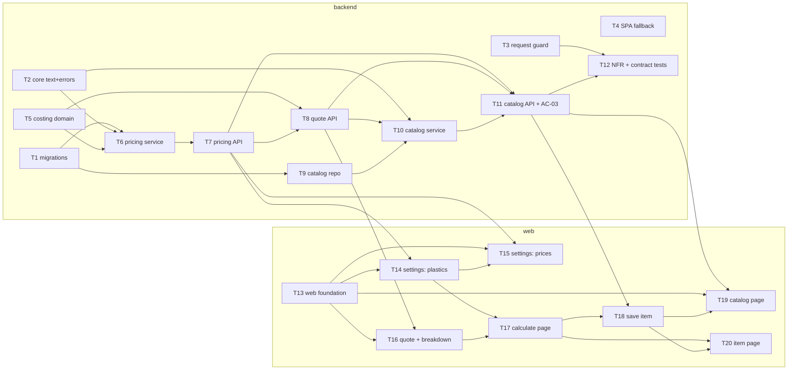

# Epic — cost-calculator

> **PRD:** [PRD.md](../PRD.md) · **Design:** [sad.md](../sad.md) · **Data model:** [data-model.md](../data-model.md) · **API:** [openapi.yaml](../contracts/openapi.yaml) · **ADRs:** [adr/](../adr/)

## Goal

Після цього епіку автор одразу після нарізки бачить мінімальний донат нового виробу з розбивкою собівартості, а збережені вироби в каталозі завжди мають ціну, перераховану з поточних налаштувань цін ([PRD §2](../PRD.md)). Етап 1 — робочий інструмент без імпорту зі слайсера.

## Scope

- **In:** `target_surfaces: [backend-service, web-frontend]` ([sad.md](../sad.md) frontmatter). Backend: 4 міграції, `core` (назви, розширення problem+json, захист запитів, SPA fallback), модулі `pricing` · `costing` · `catalog` ([ADR-0005](../adr/0005-split-feature-into-pricing-costing-catalog-modules.md)). Web: React Router, `shared/lib` (parse-decimal, format-money), сторінки `settings` · `calculate` · `catalog` · `item` з наявних shadcn/ui-примітивів.
- **Out:** імпорт файлу слайсера, праця / пакування / націнка, облік продажів та історія цін, кілька принтерів чи користувачів, публічна картка ціни ([PRD §3](../PRD.md)).

## Task map

Дві гілки стартують одночасно: backend (T1, T2, T3, T4, T5) і web (T13). Вони сходяться на задачах, яким потрібен згенерований `schema.d.ts`.

**Фази (топологічний порядок DAG):**

1. T1, T2, T3, T4, T5, T13
2. T6, T9
3. T7
4. T8, T14
5. T10, T15, T16
6. T11, T17
7. T12, T18
8. T19, T20

**Черги серіалізації (`implement-tasks`):** `migration` — лише T1. Спільні `files_hint`: `main.py` (T3, T4, T7, T8, T11) · `schema.d.ts` (T7, T8, T11) · `tests/factories.py` (T6, T9) · `pages/settings` (T14, T15) · `entities/item` (T18, T19, T20) · `shared/ui/index.ts` (T14, T17).

## Tasks

See [tracker.md](./tracker.md) for status. Machine contract: [tasks.json](./tasks.json).

| # | Task | Layer | Blocked by | ACs |
|---|---|---|---|---|
| [T1](./T1-promote-migrations.md) | Перенести 4 staged-міграції в ланцюжок Alembic і задокументувати суфікси одиниць | migration | — | AC-03, AC-09, AC-15 |
| [T2](./T2-core-names-and-problem-extensions.md) | Додати core/text.py (trim, name_key, пошук, український порядок) і поля-розширення AppError | domain | — | AC-02, AC-03, AC-09, AC-11, AC-12 |
| [T3](./T3-request-guard.md) | Додати middleware захисту запитів: allowlist Host, same-origin, JSON-only | wiring | — | AC-16, AC-16b |
| [T4](./T4-spa-fallback.md) | Віддавати index.html для будь-якого не-/api шляху (SPA fallback) | wiring | — | AC-09, AC-14 |
| [T5](./T5-costing-domain-formula.md) | Реалізувати чисту формулу собівартості costing.domain на Decimal з еталонною таблицею | domain | — | AC-04, AC-06, AC-06b, AC-08, AC-08b, AC-13 |
| [T6](./T6-pricing-service.md) | Зібрати модуль pricing: tables, repo, service, schemas для пластиків і налаштувань цін | app | T1, T2, T5 | AC-01, AC-02, AC-03, AC-04, AC-05 |
| [T7](./T7-pricing-router.md) | Відкрити /api/pricing: CRUD пластиків і GET/PUT налаштувань цін | ports | T6 | AC-01, AC-02, AC-04, AC-05 |
| [T8](./T8-costing-quote-endpoint.md) | Реалізувати costing.service.quote() і POST /api/costing/quote | ports | T5, T7 | AC-06, AC-06b, AC-07, AC-08, AC-09 |
| [T9](./T9-catalog-repo.md) | Додати catalog tables + repo: вироби з рядками витрати, пакетне читання без N+1 | infra | T1 | AC-03, AC-10, AC-12, AC-14b, AC-15 |
| [T10](./T10-catalog-service.md) | Реалізувати catalog.service: збереження, редагування, видалення, пошук і перерахунок цін | app | T2, T8, T9 | AC-10, AC-11, AC-12, AC-13, AC-14, AC-14b, AC-14c, AC-15 |
| [T11](./T11-catalog-router-and-plastic-in-use.md) | Відкрити /api/catalog/items і підключити перевірку використання пластику в pricing (AC-03) | ports | T7, T8, T10 | AC-03, AC-10, AC-11, AC-12, AC-13, AC-14, AC-14b, AC-14c, AC-15 |
| [T12](./T12-nfr-and-contract-tests.md) | Додати тести NFR (латентність, збереженість, узгодженість цін) і контрактний тест OpenAPI | tests | T3, T11 | AC-01, AC-03, AC-04, AC-06, AC-10, AC-12, AC-13, AC-15, AC-16b |
| [T13](./T13-web-foundation.md) | Підключити React Router, оболонку з навігацією, parse-decimal і format-money | ui | — | AC-01, AC-02, AC-05, AC-07, AC-09 |
| [T14](./T14-settings-plastics-ui.md) | Зібрати розділ пластиків на /settings: список, додавання, редагування, видалення з підтвердженням | ui | T7, T13 | AC-01, AC-02, AC-03 |
| [T15](./T15-settings-price-form-ui.md) | Зібрати форму налаштувань цін на /settings: 6 полів, одне збереження, знос за годину | ui | T7, T13, T14 | AC-04, AC-05 |
| [T16](./T16-quote-entity-and-breakdown-widget.md) | Додати entity quote (debounce + ключ запиту) і віджет cost-breakdown | ui | T8, T13 | AC-06, AC-06b, AC-08, AC-08b |
| [T17](./T17-calculate-page-quote-form.md) | Зібрати сторінку /calculate з формою quote-form, валідацією AC-07 і станом «бракує налаштувань» | ui | T14, T16 | AC-06, AC-06b, AC-07, AC-09 |
| [T18](./T18-save-item-ui.md) | Додати збереження розрахунку в каталог (feature save-item) на /calculate | ui | T11, T17 | AC-10, AC-11 |
| [T19](./T19-catalog-page-ui.md) | Зібрати сторінку /catalog: пошук за ?q= і список виробів з актуальним мінімальним донатом | ui | T11, T13, T18 | AC-12, AC-13 |
| [T20](./T20-item-page-ui.md) | Зібрати сторінку /catalog/:itemId: перегляд, редагування через quote-form і видалення | ui | T17, T18 | AC-14, AC-14b, AC-14c, AC-15 |

### AC coverage

| AC | Tasks |
|---|---|
| AC-01 | T6, T7, T12, T13, T14 |
| AC-02 | T2, T6, T7, T13, T14 |
| AC-03 | T1, T2, T6, T9, T11, T12, T14 |
| AC-04 | T5, T6, T7, T12, T15 |
| AC-05 | T6, T7, T13, T15 |
| AC-06 | T5, T8, T12, T16, T17 |
| AC-06b | T5, T8, T16, T17 |
| AC-07 | T8, T13, T17 |
| AC-08 | T5, T8, T16 |
| AC-08b | T5, T16 |
| AC-09 | T1, T2, T4, T8, T13, T17 |
| AC-10 | T9, T10, T11, T12, T18 |
| AC-11 | T2, T10, T11, T18 |
| AC-12 | T2, T9, T10, T11, T12, T19 |
| AC-13 | T5, T10, T11, T12, T19 |
| AC-14 | T4, T10, T11, T20 |
| AC-14b | T9, T10, T11, T20 |
| AC-14c | T10, T11, T20 |
| AC-15 | T1, T9, T10, T11, T12, T20 |
| AC-16 | T3 |
| AC-16b | T3, T12 |

21/21 AC з PRD §5 покрито.

## Risks / Hard rules

- **Модулі спілкуються лише через `service.py`** ([ADR-0005](../adr/0005-split-feature-into-pricing-costing-catalog-modules.md), CLAUDE.md). `pricing.service` не знає про `catalog`; перевірку AC-03 передає параметром роутер (T11).
- **Router → service → repo**; сервіси без імпортів FastAPI/SQL; доменні помилки — підкласи `AppError`, ніколи `HTTPException` (CLAUDE.md § Errors).
- **Гроші й кількості — масштабовані цілі** (`*_kop`, `*_cg`, `*_permille`, `*_s`, `*_w`, `*_h`); `Decimal` лише в `costing.domain`; донат — `ROUND_CEILING` з точної суми, рядки — `ROUND_HALF_UP` ([ADR-0002](../adr/0002-compute-cost-on-server-only.md), [ADR-0004](../adr/0004-exchange-quantities-as-scaled-integers.md), sad §11).
- **Ціна виробу ніколи не зберігається** і не кешується між читаннями ([ADR-0003](../adr/0003-recompute-catalog-prices-on-every-read.md)).
- **БД — тупе сховище:** без CHECK / TRIGGER / бізнес-дефолтів; SQL-first міграції, по одному твердженню на `op.execute` (`.claude/rules/migrations.md`).
- **Bind лише `127.0.0.1`**, без CORS; захист — allowlist `Host` + same-origin + JSON-only ([ADR-0007](../adr/0007-guard-local-api-with-host-allowlist-and-same-origin-checks.md), project ADR 0004).
- **UI нічого не рахує** і показує лише відповідь для поточних значень ([ADR-0002](../adr/0002-compute-cost-on-server-only.md)); нові примітиви — лише через `npx shadcn add` у `shared/ui/` (FSD + Steiger).
- **`make check` зелений перед кожним комітом** — зокрема `api-types-check`, тож кожна задача, що змінює роутер, сама регенерує `schema.d.ts`.
- NFR латентності (QG-2) перевіряється лише локально (skip на `CI`) — sad §10/§11.
