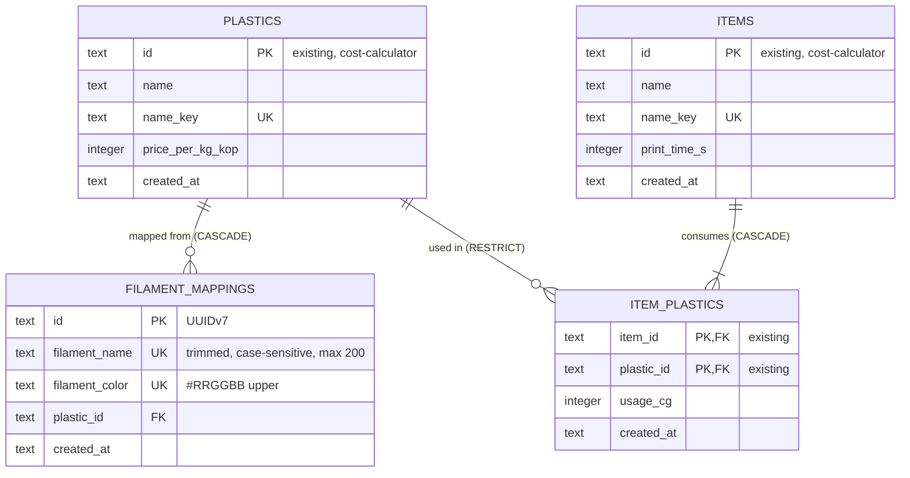

# Data model — print-file-import

<!-- Generated by generate-data-model. Migrations are STAGED under
docs/features/print-file-import/migrations/ (NOT the live backend/migrations/versions/ tree);
implement-tasks promotes them. -->

> **Inputs:** [PRD](PRD.md) §4–§6 (US-03; AC-07..AC-11, §6 «Збереженість зіставлень») · [SAD](sad.md) §4, §5 (`importing/tables.py`), §6 потоки 1, 2, 6, 7, §7 «Scaling thresholds», §8 («Нормалізація філамента», ID strategy, Quantities, Transactions) · ADR [0001](adr/0001-parse-slicer-file-on-server-and-keep-only-numbers.md), [0003](adr/0003-remember-filament-mappings-in-the-item-save-transaction.md), [0004](adr/0004-compose-quote-rows-in-the-web-from-exact-milligrams.md), [0005](adr/0005-add-an-importing-module-that-owns-the-parser-and-filament-mappings.md) · [data-model етапу 1](../cost-calculator/data-model.md) (`plastics`, `items`, `item_plastics`).
> **Dialect:** SQLite 3 (`foreign_keys=ON`, WAL, `BEGIN IMMEDIATE`). Дефолти курсу застосовано в SQLite-формі — `.claude/rules/migrations.md` § Repo adaptation.

Фіча додає **одну** таблицю — `filament_mappings` у новому модулі `importing` (ADR 0005). Наявні таблиці не змінюються: `plastics` (pricing), `items` / `item_plastics` (catalog) лишаються як в етапі 1. Нічого з самого файлу слайсера не зберігається — ні байтів, ні розібраних філаментів, ні часу, ні номера пластини (ADR 0001; PRD §6 «Файл не зберігається»). Розібраний файл живе лише у відповіді API та в стані форми вебу, а в каталог потрапляє тим самим шляхом, що й ручне введення: `items.print_time_s` + `item_plastics.usage_cg`.

## ER diagram

`FILAMENT_MAPPINGS` **не** пов'язана з `ITEMS`: зіставлення записується разом зі збереженням виробу (ADR 0003), але виробу не належить. Інші вироби вказують на пластик, а не на зіставлення, тож заміна зіставлення їх не торкається (AC-08). Унікальний ключ — пара `(filament_name, filament_color)`.

## Entities

Спільне (дефолти курсу в SQLite-формі, як в етапі 1):
- PK — UUIDv7 з `core/ids.py::new_id()`, `TEXT` 36 символів; БД ID не генерує (SAD §8 ID strategy).
- `created_at TEXT NOT NULL DEFAULT (strftime('%Y-%m-%dT%H:%M:%fZ', 'now'))` — UTC ISO-8601.
- **`updated_at` немає.** Зіставлення змінне (upsert замінює `plastic_id`, AC-08), але PRD не вимагає знати, коли його змінено, а окремого перегляду зіставлень немає (PRD §3). Тому `created_at` означає «коли філамент уперше зіставлено» і під час upsert не змінюється.
- Hard delete: зіставлення зникає лише каскадом разом із пластиком (AC-11). Окремого видалення немає (PRD §3). Без `CHECK` / `TRIGGER` / бізнес-`DEFAULT`: форму назви й кольору перевіряють парсер і Pydantic.
- Рядки — `TEXT` (рішення етапу 1, конвенція репо). Межі довжини тримає Pydantic.

### Aggregate `importing` → `filament_mappings`

| Column | Type | Constraints | Notes |
|---|---|---|---|
| `id` | TEXT | PK, app-generated (UUIDv7) | лишається тим самим під час upsert |
| `filament_name` | TEXT | NOT NULL; UNIQUE разом із `filament_color` | назва пресету з `filament_settings_id[id-1]` у `project_settings.config` (SAD §8). Нормалізація — **лише** обрізання пробілів на краях, з урахуванням регістру, без NFC і без `casefold` (AC-09). 1–200 code points (Pydantic у вході `ItemInput.filament_mappings[]` і парсер: довша назва з файлу → «файл пошкоджений», SAD §8). Еталон: `Bambu PLA Basic @BBL A1M` (24 символи) |
| `filament_color` | TEXT | NOT NULL; UNIQUE разом із `filament_name` | рівно `#RRGGBB`, `[0-9A-F]` у верхньому регістрі. `#ffffff` і `#FFFFFFFF` нормалізуються до `#FFFFFF`, а будь-яка інша форма → «пошкоджений» (AC-09, SAD §8). Pydantic перевіряє той самий шаблон `^#[0-9A-F]{6}$` у вході збереження виробу, тож ключ у БД завжди канонічний |
| `plastic_id` | TEXT | NOT NULL, FK → `plastics(id)` **ON DELETE CASCADE**; індекс `idx_filament_mappings_plastic_id` | обраний автором пластик. Каскад забуває зіставлення під час видалення пластику (AC-11; ADR 0003): видалений пластик ніколи не підставляється, а `pricing` про таблицю не знає. Зіставлення власної ціни не має — ціна завжди з `plastics.price_per_kg_kop` (AC-11) |
| `created_at` | TEXT | NOT NULL DEFAULT (UTC ISO-8601) | момент першого зіставлення; upsert його не змінює |

**Aggregate root:** root (модуль `importing`, ADR 0005). Інші модулі пишуть сюди лише через `importing.service.remember_mappings(conn, mappings)` з `Connection` транзакції збереження виробу (ADR 0003). Читає таблицю лише `importing.service.parse_slicer_file` (підставлення пластиків).

**Чому сурогатний `id`, а не PK `(filament_name, filament_color)`:** SAD §8 (ID strategy) прямо вимагає UUIDv7 для рядків зіставлень. Природний ключ при цьому тримає UNIQUE-індекс, а `id` дає стабільний ідентифікатор, якщо колись з'явиться окремий перегляд зіставлень (зараз це non-goal, PRD §3). На відміну від `item_plastics` (етап 1, складений PK), зіставлення — самостійна сутність, а не дочірній рядок, що замінюється цілком.

**Access patterns (з SAD §6):**
1. **Пошук під час розбору** (потік 1, потік 7): `SELECT filament_name, filament_color, plastic_id FROM filament_mappings WHERE (filament_name, filament_color) IN (…)` — до 32 пар, по одній на філамент файлу → `uq_filament_mappings_name_color`.
2. **Upsert під час збереження виробу** (потік 2, потік 6; AC-07, AC-08, AC-10): `INSERT … ON CONFLICT (filament_name, filament_color) DO UPDATE SET plastic_id = excluded.plastic_id`. Конфлікт ловить той самий UNIQUE-індекс. `id` і `created_at` наявного рядка лишаються. Для AC-10 (сумування двох різних філаментів в один пластик) це просто два рядки з однаковим `plastic_id`, тож UNIQUE на `plastic_id` немає й бути не може.
3. **Каскадне видалення** (потік 7; AC-11): `DELETE FROM plastics WHERE id = ?` → SQLite шукає дочірні рядки за `plastic_id` → `idx_filament_mappings_plastic_id`.

**Constraints:**
- UNIQUE `(filament_name, filament_color)` — «той самий пресет іншого кольору — інше зіставлення», а дві однакові котушки у двох слотах мають спільне зіставлення (AC-09, AC-10). Порівняння SQLite за замовчуванням `BINARY`, тобто регістрочутливе, і саме це вимагає AC-09 для назви. Для кольору регістр знімає нормалізація застосунку (`#ffffff` → `#FFFFFF`) ще до запису.
- FK `plastic_id` → `plastics(id)` ON DELETE CASCADE. Якщо пластик видалено між імпортом і збереженням виробу, INSERT падає з `IntegrityError` (FOREIGN KEY), `importing.repo` перетворює його на repo-виняток, `importing.service` — на доменну помилку, і вся транзакція виробу відкочується (SAD §6 потік 6, flag; ADR 0003). Код помилки фіксує `api-forge`.

**Обсяг:** десятки рядків за рік (SAD §7, ≈25 імпортів на квартал). Інших індексів не потрібно.

### Наявні таблиці — без змін

| Table | Module | Що робить імпорт |
|---|---|---|
| `plastics` | pricing | Читає наявність (AC-04, через `pricing.service`). На `id` тепер посилається `filament_mappings.plastic_id` з CASCADE. `ON DELETE RESTRICT` з боку `item_plastics` і перевірка `ItemInUse` у `pricing.service` лишаються єдиним, що блокує видалення пластику (AC-11) |
| `price_settings` | pricing | Читає наявність (AC-04) |
| `items` | catalog | Імпорт перезаписує `print_time_s` (кратне 60, AC-03) лише під час підтвердженого збереження (AC-05, AC-06), назва не змінюється |
| `item_plastics` | catalog | Імпорт замінює весь набір рядків виробу (AC-05) з `usage_cg`, які веб склав із точних `usage_mg` (ADR 0004). У БД `*_mg` не з'являється |

Що свідомо **не** зберігається (model-vs-spec, див. аудит): файл слайсера, розібрані філаменти (`usage_mg`, тип), номер і назва імпортованої пластини, зв'язок «виріб ← з якого файлу», історія «було → стало», незавершений імпорт (AC-09b).

## Indexes

| Index | Columns | Query it serves |
|---|---|---|
| `uq_filament_mappings_name_color` (UNIQUE) | `filament_mappings(filament_name, filament_color)` | SAD §6 потік 1 «шукає зіставлення за назвою й кольором філаментів» і потік 7 (повторний імпорт, AC-11). Ціль конфлікту upsert у потоках 2 і 6: «upsert за назвою й кольором» (AC-07, AC-08). Гарантія «одне зіставлення на філамент» (AC-09, AC-10) |
| `idx_filament_mappings_plastic_id` | `filament_mappings(plastic_id)` | SAD §6 потік 7 «зіставлення на цей пластик видаляються каскадом» (AC-11): пошук дочірніх рядків під час `DELETE FROM plastics`. Водночас обов'язковий FK-індекс (`.claude/rules/migrations.md`) |

Відкинуті кандидати: окремий індекс на `filament_name` (його покриває ліва колонка UNIQUE, а запиту лише за назвою немає), на `created_at` (за ним жоден запит не фільтрує й не сортує) і UNIQUE на `plastic_id` (AC-10 дозволяє кілька філаментів на один пластик). Обидва запити з таблиці перевірено `EXPLAIN QUERY PLAN` на SQLite 3.54: `SEARCH filament_mappings USING INDEX uq_filament_mappings_name_color (filament_name=? AND filament_color=?)`, зокрема для форми `(…) IN (VALUES …)`.

## Staged migrations

| Order | Up / Down | Module |
|---|---|---|
| 1 | [`20261110120000_create_filament_mappings`](migrations/20261110120000_create_filament_mappings.up.sql) · [down](migrations/20261110120000_create_filament_mappings.down.sql) | importing |

Залежить від `plastics` (live-ревізія `20261028_2230_create_plastics.py`). **Під час promote:** пара стає Alembic-ревізією `backend/migrations/versions/YYYYMMDD_HHMM_create_filament_mappings.py` з `down_revision` = поточний head (`65f15a51514f`, `create_item_plastics`, якщо до того часу нічого не додано). **Кожне SQL-твердження — окремий `op.execute("""…""")`**: у `upgrade()` їх 3, у `downgrade()` теж 3. Дзеркало в `modules/importing/tables.py` — `Table("filament_mappings", metadata, …)` з `Index("uq_filament_mappings_name_color", "filament_name", "filament_color", unique=True)` і `ForeignKey("plastics.id", ondelete="CASCADE")`, як у `pricing/tables.py`.

**Seeds:** немає. Зіставлення з'являються лише з дій автора (AC-07), а bootstrap- і lookup-даних фіча не потребує.

## Test fixtures

Фабрики **не** в міграціях. Їх додає `implement-tasks` у наявний `backend/tests/factories.py` разом із `importing/tables.py`, бо модуля `importing` ще немає, і код фабрики не пройшов би `mypy --strict`:

- `make_filament_mapping(conn, *, plastic_id, filament_name="Bambu PLA Basic @BBL A1M", filament_color="#FFFFFF") -> str` — пише через SQLAlchemy Core у `Connection`, повертає `id`. Дефолти — еталон `vtulka_A` (AC-01, AC-11).
- Для AC-02 тести викликають її тричі з кольорами еталона «LITTLE_TREES»: `#3F8E43`, `#000000`, `#FEC600`. Коричневий `#6F5034` навмисно лишається без зіставлення.

Еталонні файли (`tests/fixtures/slicer/`) і генератор поганих файлів — тестові дані парсера, а не БД. Їх описує SAD §10 QG-1/QG-2.

PII guard: назви — товарні назви пресетів і пластиків. Людей, email і телефонів немає.

## Відхилення від конвенцій (див. також аудит)

- **`TEXT` замість `VARCHAR(N)`** для `filament_name` / `filament_color`: конвенція репо та рішення етапу 1. Межі (200 code points, `^#[0-9A-F]{6}$`) — у Pydantic і цьому документі.
- **Сурогатний `id` + UNIQUE на природному ключі** замість складеного PK (як в `item_plastics`): так вимагає SAD §8 ID strategy, обґрунтування — вище.
- **`created_at` у змінній таблиці без `updated_at`**: дефолт курсу «immutable-first». Upsert змінює `plastic_id`, а `created_at` лишається моментом першого зіставлення.
