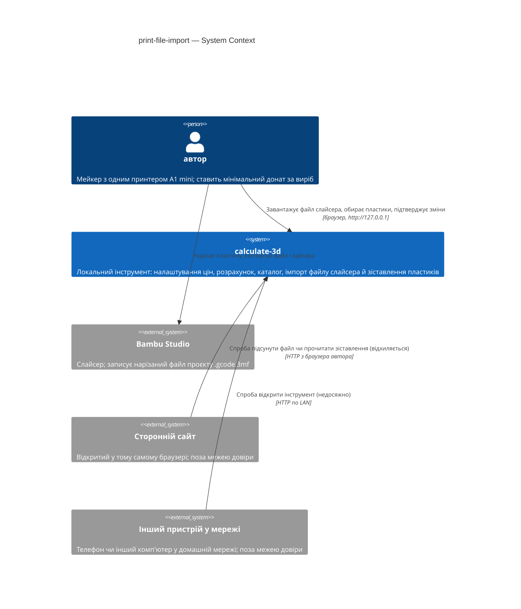
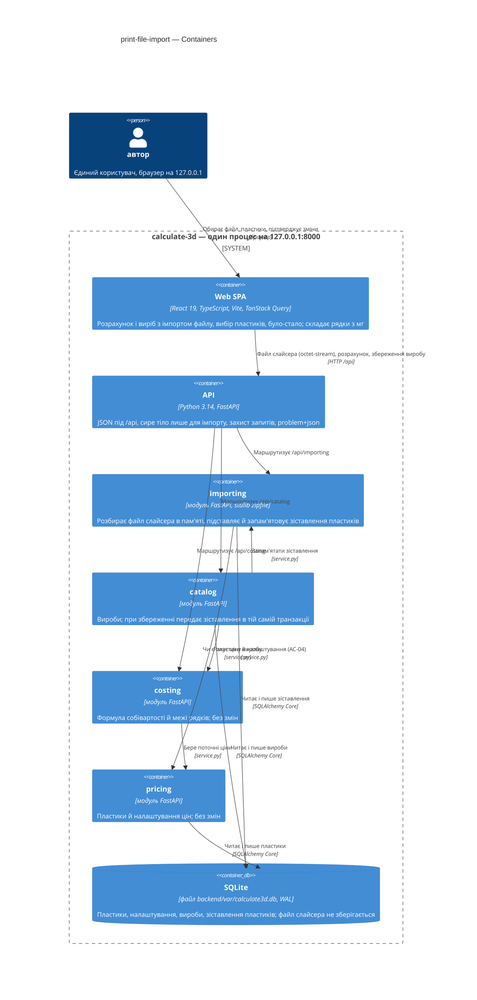
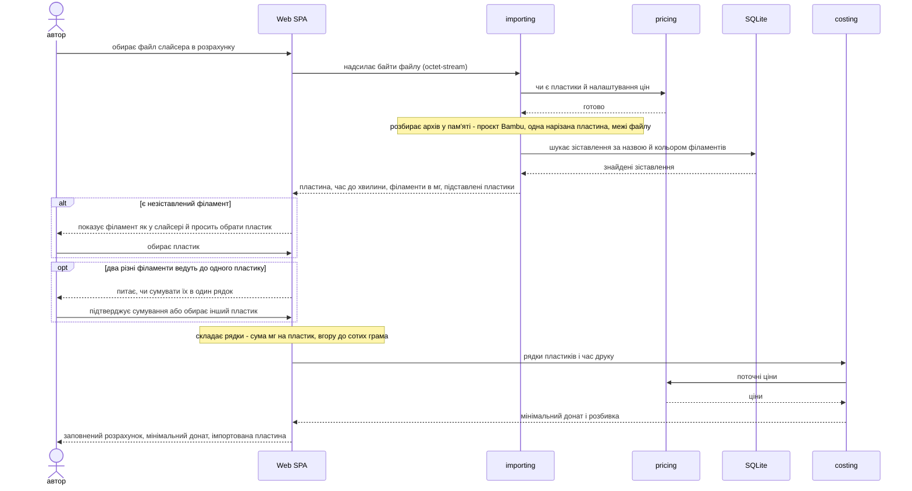
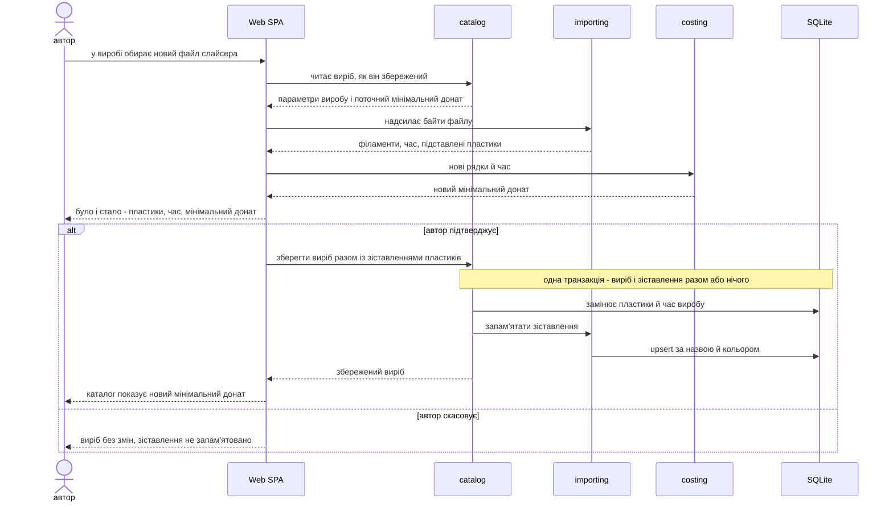
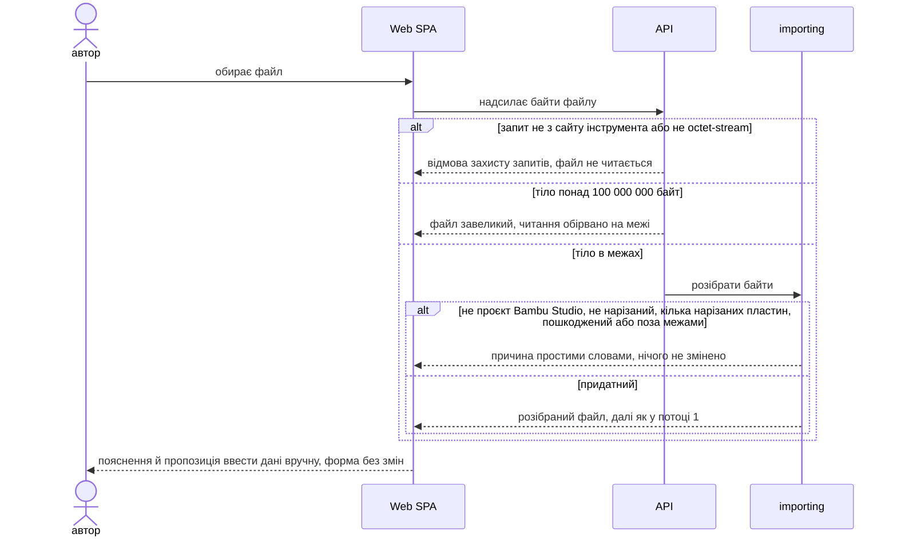

# Software Architecture Document — print-file-import

<!-- Stages 04-05 → see sdlc/plugin/skills/architecture-design/SKILL.md -->
<!-- 12 Arc42 sections. Empty sections — <!-- N/A: <one-line reason> -->. -->
<!-- C4 Context (L1) lives inline in §3. C4 Container (L2) lives inline in §5. -->
<!-- §6 Runtime view seeds the primary flow(s) here; complete-sequence-diagrams (stage 06) then -->
<!--    fills §6 with every critical flow / §5 AC — no cap. -->
<!-- Numbers in §10 come VERBATIM from PRD §6 NFR — no inventing, no rounding. -->

## 1. Introduction and goals

**Intent.** Імпорт файлу слайсера — етап 2 продукту (підхід C, PRD §1): **автор** відкриває **розрахунок** або наявний **виріб**, завантажує нарізаний файл проєкту Bambu Studio, і інструмент бере з нього витрату кожного **філамента слайсера** (разом із промивкою та вежею очищення) і час друку. Далі він підставляє запам'ятовані **зіставлення пластиків** (або один раз просить обрати пластик) і перераховує **мінімальний донат** тим самим шляхом, що й ручне введення етапу 1. Наявний виріб імпорт не змінює мовчки: до збереження видно «було → стало», а зміна застосовується лише цілком. Непридатний файл відхиляється з поясненням і пропозицією ввести дані вручну. Сам файл інструмент не зберігає — лише числа з нього (PRD §2, §3; глосарій «імпорт»).

**Top quality goals (1-liners; full scenarios in §10; порядок = пріоритет при конфлікті):**

1. **QG-1 Точність імпорту** — 100 % збіг зі слайсером на всіх еталонних файлах (грами й час за правилом AC-03 — числа файлу, округлені вгору); 0 тихих хибних імпортів.
2. **QG-2 Стійкість до поганих файлів** — 100 % пошкоджених, підроблених і «бомбових» файлів відхиляються з поясненням, без збою чи зависання інструмента; 0 байтів файлу на диску після імпорту.
3. **QG-3 Доступ лише автору** — сторонній сайт у браузері автора не може підсунути файл, прочитати чи змінити зіставлення пластиків; з іншого пристрою інструмент недоступний (AC-15).
4. **QG-4 Чуйність** — імпорт p95 ≤ 5 с для будь-якого файлу до межі розміру 100 МБ.

**Stakeholders.**

| Role | Interest | Sign-off owner? |
|---|---|---|
| автор | єдиний користувач (розрахунок, каталог, налаштування цін, тепер — імпорт і зіставлення пластиків); водночас власник продукту, архітектор і розробник навчального проєкту | Yes |

**Decision overrides.**

- Decision override: правило кількості пластин — файл відхиляється, лише коли понад одна пластина має результати нарізки; ненарізані пластини пропускаються, а інструмент показує, яку пластину імпортовано — rationale: багатоколірний еталон «LITTLE_TREES» містить 10 пластин, з яких нарізана лише одна, тож неоднозначності немає; PRD §3, AC-02, AC-13 і §8 №1 оновлено в коміті `e62935c` перед цим проходом.

## 2. Constraints

**Technical** (версії — з `backend/uv.lock` і `web/package.json` на 2026-11-09).
- Python **3.14.6** (через `uv`) · FastAPI **0.162** (Starlette 1.10) · Pydantic **2.14** · Uvicorn 0.54.
- SQLite **3.53** — один файл, `journal_mode=WAL`, `foreign_keys=ON`, кожна транзакція — `BEGIN IMMEDIATE` · SQLAlchemy **2.1** Core (без ORM) · Alembic **1.20**, міграції SQL-first (project ADR 0003).
- React **19.3** + TypeScript **5.9** + Vite **8.3** · React Router **8.5** (cost-calculator ADR 0001) · Tailwind CSS **4.3** + shadcn/ui (`web/src/shared/ui/`: button, card, input, label, table, alert-dialog, form-field, select) · TanStack Query **5.105** · `openapi-fetch` 0.17 + `openapi-typescript` (типи вебу генеруються з OpenAPI бекенду).
- Модульний моноліт router → service → repo; модулі спілкуються лише через `service.py` іншого модуля, межі перевіряє `tests/unit/test_module_boundaries.py` (project ADR 0002). Веб — Feature-Sliced Design, контроль імпортів — Steiger.
- Один процес, bind лише на `127.0.0.1`, без автентифікації (project ADR 0004); без фонових воркерів і багатопроцесних серверів (project ADR 0003).
- **Розбір файлу — лише стандартна бібліотека Python:** `zipfile`, `xml.etree.ElementTree`, `json`; нових runtime-залежностей фіча не додає. Вбудований Expat **2.8.1** захищає від експоненційного розгортання сутностей («billion laughs») з версії 2.4, а ElementTree не завантажує зовнішніх сутностей (XXE); обидва факти закріплює тест із набору поганих файлів (§10 QG-2).
- **Brownfield-факти, що обмежують імпорт:**
  - `core/guard.py` (`RequestGuard`, cost-calculator ADR 0007) відповідає `415` на кожен `POST/PUT/PATCH/DELETE` до `/api` з тілом, `Content-Type` якого не `application/json`.
  - Межі розміру тіла запиту немає ні в застосунку, ні в Uvicorn; `python-multipart` не встановлено.
  - Вхід розрахунку — `costing` `QuoteInput`: `plastics[{plastic_id, usage_cg}]` (1–32 рядки, без повтору пластику), `print_time_s` (кратний 60, від 60 до 360 000 000), `usage_cg` від 1 до 100 000 000. Ці межі — межі імпорту (PRD AC-14).
  - Таблиці `plastics` (pricing) і `items` / `item_plastics` (catalog) не мають поняття філамента слайсера чи зіставлення.

**Organisational.**
- Одна людина: автор — водночас PM, архітектор і розробник.
- Бюджет E = 2 тижні (idea-brief §11), без жорсткого дедлайну; навчальний проєкт, що проходить повний SDLC-пайплайн.
- Гейт якості перед кожним комітом і в CI — `make check` (`api-check` + `web-check` + `api-types-check`).

**Conventions.**
- Кореневий `CLAUDE.md` + `backend/CLAUDE.md` + `web/CLAUDE.md` — джерело конвенцій. `docs/architecture-map.md` описує стан до scaffold і застарів (`reflects_commit: 95f8e06`) — цей прохід спирається на свіжий скан коду (див. §11).
- IDs — UUIDv7 із застосунку (`core/ids.py::new_id()`), `TEXT` 36 символів; БД ID не генерує.
- Гроші й кількості — масштабовані цілі числа з одиницею в назві (`*_kop`, `*_cg`, `*_s`; cost-calculator ADR 0004); точні проміжні значення — `Fraction`, мінімальний донат округлюється вгору (`ROUND_CEILING`); `float` для грошей і кількостей заборонено.
- Помилки — `AppError(code, message, status)` → RFC 9457 `application/problem+json`; коди модуля — `<module>.<error_name>`; сервіси не кидають `HTTPException`.
- Міграції — `backend/migrations/versions/YYYYMMDD_HHMM_<slug>.py`, SQL-first, upgrade → downgrade → upgrade (тест); правила `.claude/rules/migrations.md` (адаптація для SQLite).
- Каталог зберігає параметри виробу, а не ціну; ціна завжди перераховується з поточних налаштувань цін.

**Regulatory / external.**
- Особистих даних немає; зіставлення пластиків — внутрішні дані на рівні налаштувань цін (PRD §6.1). Файл слайсера може містити службові дані (назви об'єктів і пластин, версію слайсера) — інструмент бере лише числа, назву, тип і колір філамента й відкидає файл.
- Security review обов'язковий (PRD §6.1): безпечне читання архіву, межа розміру, захист від запитів сторонніх сайтів. Abuse cases PRD §6.1 (сторонній сайт, інший пристрій, шкідливий архів, назва філамента як код/розмітка) покривають §8 і §10 QG-2/QG-3.
- Зовнішніх регуляторних вимог (GDPR, PCI) немає: локальний інструмент одного автора без облікових записів (project ADR 0004).

## 3. Context and scope

Автор нарізає пластину в Bambu Studio, експортує нарізаний файл проєкту й завантажує його в розрахунок або в наявний виріб; інструмент бере з файлу витрату кожного філамента слайсера та час друку, підставляє зіставлення пластиків і показує мінімальний донат (для виробу — «було → стало» до збереження) (PRD §1). Інструмент лишається однією системою на комп'ютері автора без мережевих інтеграцій: файл приходить від автора через браузер, і жодного API слайсера чи сайту моделей інструмент не викликає. Межа довіри (trust boundary — лінія, за якою дані не приймаються без перевірки) та сама, що в етапі 1, — комп'ютер автора, — але з'являється новий вид вхідних даних поза нею: **вміст файлу слайсера**. Навіть принесений самим автором, файл міг бути зібраний чужою людиною (проєкти з сайтів моделей містять чужі налаштування й вкладення — еталон «LITTLE_TREES» несе картинки й профіль автора моделі), тож кожен байт архіву вважається недовіреним, доки його не перевірено (PRD §6.1).

**External systems (in / out):**

| Actor or system | Type | Interaction |
|---|---|---|
| автор | Person | Завантажує файл слайсера в розрахунок або у виріб, обирає пластик для незіставленого філамента, підтверджує «було → стало» — через браузер на `127.0.0.1` |
| Bambu Studio | System (external) | Нарізає пластину й записує файл слайсера (`.gcode.3mf`) на диск автора; автор передає файл інструменту сам — інтеграції немає. Вміст файлу недовірений (див. вище). OrcaSlicer у цьому етапі поза обсягом (PRD §3) |
| Сторонній сайт у браузері автора | System (external, hostile) | Може спробувати підсунути файл для імпорту, прочитати чи змінити зіставлення пластиків (CSRF, DNS rebinding); запит відхиляється (AC-15) |
| Інший пристрій у домашній мережі | System (external, hostile) | Може спробувати відкрити інструмент; сервер слухає лише `127.0.0.1`, тож з мережі він недосяжний (AC-15) |

**C4 Context (L1):**



## 4. Solution strategy

**Target surface(s) (the first decision — what's being built):** `[backend-service, web-frontend]` — ті самі API й SPA, що в етапі 1: автор працює лише через браузер (PRD §4), а правила, налаштування цін і каталог живуть у бекенді. Окремий CLI PRD не просить. Поверхні успадковано від cost-calculator, тож окремого ADR немає (критерій «незворотність» не спрацьовує — нових поверхонь не з'являється).

**UI-architecture (web-frontend):** імпорт — **крок у наявних сторінках** SPA (React Router, cost-calculator ADR 0001), без нових маршрутів. Кнопка «Імпортувати файл» з'являється в розрахунку (`/calculate`) і в редакторі виробу (`/catalog/:itemId`). Новий FSD-слайс `features/slicer-import` тримає вибір файлу, список філаментів слайсера, вибір пластику, підтвердження сумування (AC-10) і панель «було → стало» (AC-05). Розібраний файл живе лише в стані форми на екрані й зникає після збереження, скасування чи перезавантаження сторінки (AC-09b). Після імпорту рядки потрапляють у ту саму форму, тож ручні правки працюють за правилами етапу 1 (AC-01, AC-05). Нове в `shared/ui` — примітив shadcn `dialog`. Рішення inline (без ADR): воно випливає з ADR 0001 етапу 1, а альтернатива (окремий екран-майстер) змусила б передавати розібраний файл між маршрутами й дублювати редактор.

**Top strategic choices (the seeds for ADRs):**

1. **Файл розбирає сервер, а зберігаються лише числа** ([ADR 0001](adr/0001-parse-slicer-file-on-server-and-keep-only-numbers.md)) — браузер надсилає файл у бекенд, і модуль імпорту розбирає його stdlib-засобами в пам'яті. Перевірки йдуть ланцюжком AC-12: проєкт Bambu Studio → нарізаний → рівно одна нарізана пластина → цілісність → межі файлу. Сервер округлює час вгору до хвилини (AC-03), нормалізує колір і назву (AC-09), підставляє запам'ятовані зіставлення пластиків і повертає результат без жодного запису в БД. Причина — QG-1 і QG-2: усі доменні правила лишаються в одному місці з розрахунком (cost-calculator ADR 0002), еталонні й погані файли тестуються в pytest, а затримку вимірюють як «час відповіді сервера» (PRD §6).
2. **Файл передається сирим тілом `application/octet-stream` і тримається лише в пам'яті під межею 100 МБ** ([ADR 0002](adr/0002-upload-slicer-file-as-raw-octet-stream-body-held-in-memory.md)) — `RequestGuard` дозволяє цей тип лише для маршруту імпорту, а всі інші змінні запити, як і раніше, приймаються лише як JSON. Тіло читається потоком і обривається на першому байті понад межу. Причина — QG-3 і QG-2: `octet-stream` не входить до «простих» CORS-типів, тож сторонній сайт не надішле його без preflight (а preflight завжди падає, бо CORS немає). Тимчасового файлу на диску (як у multipart) немає, нової залежності теж. Закриває PRD §8 №2.
3. **Зіставлення пластиків записуються в тій самій транзакції, що й виріб** ([ADR 0003](adr/0003-remember-filament-mappings-in-the-item-save-transaction.md)) — створення й оновлення виробу в `catalog` приймають необов'язковий список зіставлень (назва + колір філамента → пластик), і `catalog.service` у тій самій транзакції викликає сервіс модуля імпорту. Причина — AC-07 дослівно: вибір запам'ятовується лише разом зі збереженим виробом, а невдале збереження (наприклад, `409` на назву) не лишає зіставлень. Зіставлення вказує на пластик через FK з `ON DELETE CASCADE`, тож видалений пластик ніколи не підставляється (AC-11), і `pricing` про зіставлення нічого не знає.
4. **Рядки розрахунку складає веб із точних міліграмів** ([ADR 0004](adr/0004-compose-quote-rows-in-the-web-from-exact-milligrams.md)) — сервер повертає витрату кожного філамента цілим `usage_mg`, а чиста TS-функція в `features/slicer-import` групує філаменти за обраним пластиком, додає мг і лише потім округлює суму вгору до `usage_cg` (AC-03, AC-10). Ціну, розбивку й межі 32 пластиків / 1 000 000 г, як і раніше, рахує й перевіряє `costing` на сервері (AC-14 — «так само, як при ручному введенні»). Причина — QG-1 без додаткового запиту на кожну зміну вибору: сервер без стану однаково не має файлу, щоб перевірити повернені браузером філаменти.

Тактичні рішення в §5–§8 мають випливати з цих чотирьох; суперечність — червоний прапорець для §11.

## 5. Building block view

Той самий модульний моноліт із простими шарами (project ADR 0002), що й в етапі 1. Фіча додає **один** вертикальний модуль `importing` (→ [ADR 0005](adr/0005-add-an-importing-module-that-owns-the-parser-and-filament-mappings.md)), який містить і розбір файлу, і таблицю зіставлень пластиків. Наявні модулі змінюються точково: `catalog` приймає зіставлення під час збереження виробу (ADR 0003), а `core/guard.py` отримує один виняток для сирого тіла файлу (ADR 0002). `pricing` і `costing` не змінюються. Залежності сервісів: `catalog → importing → pricing` (плюс наявні `catalog → costing → pricing`); циклу на рівні `service.py` немає. Веб додає один FSD-слайс `features/slicer-import`, який збирають сторінки розрахунку й виробу.

**Internal decomposition (backend):**

```
backend/src/calculate3d/
├── main.py                 # + router importing
├── core/
│   └── guard.py            # + POST маршруту імпорту приймає ЛИШЕ application/octet-stream (ADR 0002);
│                           #   решта змінних /api — і далі лише application/json
└── modules/
    ├── importing/          # НОВИЙ — імпорт файлу слайсера + зіставлення пластиків
    │   ├── router.py       # /api/importing — приймає сире тіло, читає потоком під межею
    │   │                   #   100 000 000 байт (413), віддає розібраний файл; нічого не пише
    │   ├── parser.py       # чиста функція bytes → дані файлу | помилка розбору (без I/O, як
    │   │                   #   costing/domain.py): межі архіву (§8), ланцюжок AC-12 → AC-13 → AC-14,
    │   │                   #   час ceil до хвилини, колір #RRGGBB, назва без пробілів на краях, usage_mg
    │   ├── service.py      # parse_slicer_file(): готовність налаштувань (pricing.service, AC-04) →
    │   │                   #   parser → підстановка зіставлень; remember_mappings(): upsert (ADR 0003)
    │   ├── schemas.py      # розібраний файл, філамент слайсера, вхід зіставлення
    │   ├── repo.py         # пошук зіставлень за (назва, колір); upsert
    │   └── tables.py       # зіставлення пластиків: (назва філамента, колір) унікальні;
    │                       #   FK → пластик ON DELETE CASCADE (AC-11)
    ├── catalog/            # ItemInput + необов'язковий список зіставлень; create/update_item
    │                       #   викликає importing.service.remember_mappings у тій самій транзакції
    ├── pricing/            # без змін (видалення пластику каскадом забуває його зіставлення)
    └── costing/            # без змін (межі 32 пластики / 1 000 000 г — AC-14)
backend/migrations/versions/  # + YYYYMMDD_HHMM_create_filament_mappings.py (SQL-first)
backend/tests/fixtures/slicer/ # еталонні файли (vtulka_A, LITTLE_TREES) + генератор поганих файлів
```

**Internal decomposition (web, FSD):**

```
web/src/
├── pages/          # calculate · item — вбудовують імпорт у наявні форми (без нових маршрутів)
├── features/
│   ├── slicer-import/  # НОВИЙ
│   │   ├── api/        # мутація розбору (TanStack Query useMutation, тіло — File, ADR 0002)
│   │   ├── model/      # compose.ts — рядки з точних мг (ADR 0004); стан імпорту; diff «було → стало»
│   │   └── ui/         # вибір файлу, список філаментів і вибір пластику, підтвердження
│   │                   #   сумування (AC-10), панель «було → стало» (AC-05), повідомлення відмов
│   ├── save-item/      # + передає зіставлення пластиків разом із виробом (ADR 0003)
│   └── quote-form/     # приймає рядки й час з імпорту, ручні правки — як в етапі 1
├── entities/       # plastic · item · quote — без змін (список пластиків для вибору)
└── shared/ui/      # + dialog (shadcn)
```

Імпорт нічого не зберігає до моменту збереження виробу: розібраний файл живе в стані `features/slicer-import` на екрані. «Було» для AC-05 — це свіжо прочитаний з каталогу виріб (`GET` виробу), а не стан форми, тож незбережені ручні зміни на екрані імпорт відкидає. Точні колонки таблиці зіставлень, поля API й коди помилок визначають `generate-data-model` і `api-forge`.

**C4 Container (L2):**



## 6. Runtime view

Нижче — три основні потоки, закладені на етапі архітектури: імпорт у розрахунок, перенарізка наявного виробу з «було → стало» і відмова для поганого файлу. Учасники — контейнери з §5. Повідомлення семантичні: ендпоінти, коди статусів і назви полів з'являться на етапі `api-forge`. Решту критичних потоків — кожен AC PRD §5 — додає `complete-sequence-diagrams`.

### Critical flow 1: імпорт файлу слайсера в розрахунок (US-01, US-03)



### Critical flow 2: перенарізка наявного виробу з «було → стало» (US-02, US-03)



### Critical flow 3: відмова для непридатного файлу (US-04, US-05)



## 7. Deployment view

Фіча перевикористовує наявну одиницю розгортання без змін: один процес Uvicorn на `127.0.0.1:8000` (`make run` — міграції, збірка `web/dist`, API + SPA з одного процесу; `make dev` — Vite на `:5173` з проксі `/api`). Нових сервісів, воркерів, змінних оточення чи каталогів на диску немає. Нова таблиця зіставлень пластиків з'являється через звичайну міграцію Alembic під час `make run` / `make migrate`.

**Monitoring:**
- Метрик, алертів і трасування немає, як і в етапі 1: локальний інструмент одного автора (PRD §6 Availability N/A).
- Затримку імпорту й межу розміру перевіряють автоматичні тести NFR (§10 QG-4), а не моніторинг.

**Scaling thresholds:**
- Пам'ять на один імпорт: тіло файлу ≤ 100 000 000 байт + розпаковані службові частини ≤ 4 × 8 000 000 байт (§8) ≈ 132 МБ піку. Імпорти йдуть по одному (один автор, PRD §6 Throughput N/A), тож пік не множиться.
- Межа 100 000 000 байт — константа в коді модуля `importing`, а не налаштування: це вимога PRD §6, а не параметр середовища.
- Таблиця зіставлень росте на кілька рядків на новий філамент (≈ десятки рядків за рік за ≈ 25 імпортів на квартал, PRD §1) — без індексів понад унікальний ключ і FK.

## 8. Crosscutting concepts

Етап 1 уже визначив більшість наскрізних правил, і фіча їх успадковує. Нові рядки — перші три: вони описують роботу з недовіреним архівом (§3) і закривають PRD §8 №4.

| Concept | Convention | Where defined |
|---|---|---|
| **Межі читання архіву** (нове; закриває PRD §8 №4) | Читаються лише 4 службові частини за **точною** назвою: `3D/3dmodel.model`, `Metadata/model_settings.config`, `Metadata/slice_info.config`, `Metadata/project_settings.config`. G-code (`Metadata/plate_N.gcode`), картинки й вкладення (`Auxiliaries/…`) **ніколи не розпаковуються**: «бомба» зі стиснутого G-code нічого не важить. Межі: каталог ZIP ≤ 10 000 записів; кожна прочитана частина ≤ 8 000 000 байт розпакованого розміру — перевіряється і за заголовком, і фактичним `read(limit + 1)`, тож заголовок, що бреше про розмір, межі не обходить. Дубльовані назви, зашифровані частини, невідомий метод стиснення чи пошкоджений ZIP → «файл пошкоджений» (AC-13). На диск нічого не витягується, шляхи з архіву не використовуються як шляхи файлової системи. Реальні частини в еталонах — від 75 байт до 59 КБ. | тут; тест-набір поганих файлів (§10 QG-2) |
| **Джерело чисел і ланцюжок перевірок** (нове) | (1) `3dmodel.model` має `<metadata name="Application">` з префіксом `BambuStudio-`, а `project_settings.config` існує, інакше «не файл проєкту Bambu Studio» (CAD-3MF, OrcaSlicer — AC-12, AC-13); (2) жодна пластина в `model_settings.config` не має `gcode_file`, а `slice_info.config` — результатів, інакше «не нарізаний» (AC-12); (3) понад одна пластина з результатами → «кілька нарізаних пластин» (AC-13); (4) цілісність: `prediction` і кожен `<filament id type color used_g>` наявні й розбираються, `id` має відповідну назву в `filament_settings_id[id-1]` (AC-13); (5) межі файлу: час > 0 і ≤ 100 000 год, хоча б один філамент із витратою > 0 (AC-14). Час — `prediction` (повний розрахунковий час разом зі змінами філаменту). Філаменти без запису в `slice_info` або з `used_g = 0` пропускаються (AC-02). Числа розбираються з рядка через `Decimal`; NaN, нескінченність, експонента й від'ємні значення → «пошкоджений». На обох еталонах ці числа збігаються із заголовком G-code. | тут; ADR 0001 |
| **Нормалізація філамента** (нове) | Колір → `#RRGGBB` у верхньому регістрі; 8-значний `#RRGGBBAA` втрачає альфу; інша форма → «пошкоджений» (AC-09). Назва пресету — лише обрізання пробілів на краях, з урахуванням регістру й без NFC-нормалізації, щоб збіг зі зіставленням був точним (AC-09). Довжину назви обмежує data-model; задовга назва → «пошкоджений». | тут |
| Error handling | `AppError` → RFC 9457 `application/problem+json`; коди модуля `importing.*`: `file_too_large` (413), `settings_missing` (409, з `missing` — як `costing.settings_missing`, AC-04), а відмови ланцюжка AC-12…AC-14 — 422 зі своїм кодом на кожну причину, щоб веб показав пояснення українською. Остаточні назви кодів і полів фіксує `api-forge`. | `CLAUDE.md` § Errors; `core/errors.py` |
| Authentication / захист запитів | Без автентифікації (project ADR 0004). `RequestGuard` (cost-calculator ADR 0007) + **поправка ADR 0002**: `POST` маршруту імпорту приймає лише `application/octet-stream`, решта змінних `/api` — лише `application/json`; `Host` / `Origin` / `Sec-Fetch-Site` — без змін; CORS немає (AC-15). | cost-calculator ADR 0007; ADR 0002 |
| Output encoding (XSS) | Назви, типи й кольори філаментів із файлу React рендерить лише як текст; `dangerouslySetInnerHTML` у слайсі імпорту заборонено; колір показується зразком лише після нормалізації сервером до `#RRGGBB` (PRD §6.1). | тут |
| Logging | Тіло запиту, вміст файлу й назви з нього ніколи не логуються; у помилці 500 — лише код `internal_error` без деталей файлу. | тут |
| ID strategy | UUIDv7 із застосунку (`core/ids.py::new_id()`) для рядків зіставлень; БД ID не генерує. | `CLAUDE.md` § IDs |
| Quantities | Масштабовані цілі з одиницею в назві (cost-calculator ADR 0004). Новий суфікс `*_mg` — точна витрата філамента лише у відповіді розбору (ADR 0004); у БД і в `costing` — як і раніше `*_cg`; час — `*_s`, кратний 60. | `CLAUDE.md` § Money/units; ADR 0004 |
| Transactions | Одна транзакція на запит (`ConnectionDep`, `BEGIN IMMEDIATE`); розбір нічого не пише; виріб і зіставлення пишуться в одній транзакції (ADR 0003). | `core/db.py`; ADR 0003 |
| Internationalisation | Усі повідомлення імпорту українською (PRD §6); назви філаментів показуються як у файлі; грами й час форматуються як в етапі 1. | `CLAUDE.md` § Locale |
| Observability | N/A — локальний інструмент без метрик (§7). | — |

## 9. Architecture decisions

| # | Title | Status | Section |
|---|---|---|---|
| [0001](adr/0001-parse-slicer-file-on-server-and-keep-only-numbers.md) | Parse the slicer file on the server and keep only the numbers | Accepted | §4 |
| [0002](adr/0002-upload-slicer-file-as-raw-octet-stream-body-held-in-memory.md) | Upload the slicer file as a raw application/octet-stream body held in memory | Accepted | §4, §8 |
| [0003](adr/0003-remember-filament-mappings-in-the-item-save-transaction.md) | Remember filament mappings in the item-save transaction | Accepted | §4 |
| [0004](adr/0004-compose-quote-rows-in-the-web-from-exact-milligrams.md) | Compose quote rows in the web from exact milligrams | Accepted | §4 |
| [0005](adr/0005-add-an-importing-module-that-owns-the-parser-and-filament-mappings.md) | Add an importing module that owns the parser and the filament mappings | Accepted | §5 |

ADR files live under `docs/features/print-file-import/adr/NNNN-<title>.md`. Рішення, що діють і далі без змін: project ADR 0001–0004 (`docs/adr/`) і cost-calculator ADR 0001–0007 (`docs/features/cost-calculator/adr/`); ADR 0002 доповнює cost-calculator ADR 0007 одним винятком для маршруту імпорту.

Рішення, свідомо залишені inline (не пройшли поріг масштабу удару 2 з 3): target surfaces і UI-архітектура (§4, успадковані з етапу 1), розбір лише stdlib-засобами (§2), межі читання архіву (§8), межа розміру як константа (§7).

## 10. Quality requirements

Кожна головна якість із §1 розгорнута в сценарій. Числа взято дослівно з PRD §6 (у лапках). Еталонні файли (`vtulka_A.3mf`, `vtulka_A.gcode.3mf`, `LITTLE_TREES_-_multicolor.gcode.3mf`, ≈ 5 МБ разом) копіюються в `backend/tests/fixtures/slicer/`. Погані файли та файл розміром 100 МБ генеруються в пам'яті під час тесту й у репо не зберігаються.

**QG-1. Точність імпорту**
- **When:** автор імпортує кожен еталонний файл у розрахунок і в наявний виріб.
- **Then:** «100 % збіг зі слайсером на всіх еталонних файлах (грами й час за правилом AC-03 — числа файлу, округлені вгору; мінімальний донат до копійки, зокрема AC-01, AC-05, AC-11); 0 тихих хибних імпортів». Для `vtulka_A.gcode.3mf` — «PLA білий» 11,54 г, 1 год 38 хв, мінімальний донат 18,82 ₴ (AC-01) і 22,00 ₴ після зміни ціни (AC-11); для `LITTLE_TREES` — 15,49 / 2,23 / 2,36 г, 1 год 31 хв, коричневий філамент пропущено, пластина 1 «mini christmas tree» (AC-02).
- **How verify:** `tests/integration/test_importing_reference_files.py` — параметризована таблиця «еталон → очікуваний результат розбору й мінімальний донат»; `tests/unit/test_importing_parser.py` — приклади AC-03 (1 год 37 хв 08 с → 1 год 38 хв; рівно 1 год 37 хв → без змін; 11,543 г → 11 543 мг), нормалізація кольору AC-09; Vitest `features/slicer-import/model/compose.test.ts` — 11 543 мг → 11,55 г, 2 001 + 2 001 мг → 4,01 г, сумування AC-10. KPI «0 г / 0 хв розбіжності» на 5 реальних імпортах — ручна звірка з екраном слайсера (PRD §7).

**QG-2. Стійкість до поганих файлів**
- **When:** автор імпортує файл із набору поганих: не ZIP; обрізаний ZIP; порожнє тіло; каталог із 10 001 записом; службова частина понад 8 000 000 байт; заголовок, що бреше про розмір частини; ZIP-бомба (G-code, що розпаковується в гігабайти); XML із billion laughs; XML із зовнішньою сутністю (XXE); 3MF із CAD-програми; файл із позначкою `OrcaSlicer`; ненарізаний проєкт (`vtulka_A.3mf`); дві нарізані пластини; дубльовані назви частин; NaN, нескінченність, експонента чи від'ємні грами; нульовий час або понад 100 000 год; жодного філамента з витратою.
- **Then:** «100 % пошкоджених, підроблених і «бомбових» файлів відхиляються з поясненням, без збою чи зависання інструмента»; кожна причина має свій код `importing.*` (жодного `500 internal_error`), форма й каталог не змінюються; «0 байтів файлу на диску після імпорту (успішного чи відхиленого)».
- **How verify:** `tests/integration/test_importing_bad_files.py` — параметризований прогін генератора `tests/fixtures/slicer/bad_files.py`, кожен випадок < 5 с і дає очікуваний код; `tests/integration/test_importing_no_disk.py` — порівнює вміст `tempfile.gettempdir()` і каталогу БД до та після успішного й відхиленого імпорту; юніт-тест парсера на billion laughs / XXE закріплює поведінку Expat 2.8.1 (§2).

**QG-3. Доступ лише автору**
- **When:** запит на маршрут імпорту з `Sec-Fetch-Site: cross-site` або чужим `Origin`; `multipart/form-data` чи `text/plain` на маршрут імпорту; `octet-stream` на будь-який інший змінний `/api`-маршрут; чужий `Host` (DNS rebinding); спроба відкрити інструмент з іншого пристрою в мережі.
- **Then:** AC-15 — «інструмент не приймає файлу й змін і не віддає зіставлень сторонньому сайту, а з іншого пристрою інструмент недоступний»: `403 cross_origin_forbidden`, `415 unsupported_media_type`, `400 host_not_allowed`; тіло файлу при відмові захисту не читається; сервер слухає лише `127.0.0.1`.
- **How verify:** нові кейси в `tests/integration/test_request_guard.py` (маршрут імпорту × кожен вектор); наявний тест bind-адреси (`tests/unit/test_run.py`).

**QG-4. Чуйність**
- **When:** імпорт «від вибору файлу до заповненого розрахунку або «було → стало»» для еталонних файлів і згенерованого валідного файлу рівно 100 000 000 байт (еталон, доповнений незжатим вкладенням).
- **Then:** «≤ 5 с для будь-якого файлу до межі розміру» (p95); файл «100 МБ + 1 байт» відхиляється (`413 importing.file_too_large`, AC-13) без читання тіла далі за межу.
- **How verify:** `tests/integration/test_nfr_import_latency.py` — 20 прогонів на кожен файл, p95 часу відповіді сервера на локальній машині (відмальовування в браузері не входить — PRD §6) + випадок 100 000 001 байт; на тій самій машині, що й NFR-тести етапу 1.

**Додаткові сценарії (PRD §6):**
- **Збереженість зіставлень** — *When:* автор зберігає виріб зі зіставленнями, інструмент перезапускається; *Then:* «100 % збережених зіставлень доступні після перезапуску інструмента чи комп'ютера»; *How verify:* `tests/integration/test_importing_durability.py` — зберегти виріб → новий застосунок на тому самому файлі БД → імпорт підставляє той самий пластик; плюс AC-11: видалення пластику → імпорт знову просить обрати.
- **Локалізація** — *When:* будь-яка відмова чи підказка імпорту; *Then:* «100 % повідомлень імпорту українською; назви філаментів із файлу показуються як є»; *How verify:* юніт-тест, що кожне повідомлення `AppError` модуля `importing` українською, Vitest-тести повідомлень слайсу + ручний перегляд перед релізом.

## 11. Risks and technical debt

| Risk / debt | Severity | Mitigation | Owner |
|---|---|---|---|
| Нова версія Bambu Studio змінює службові частини архіву (`slice_info.config`, `model_settings.config`, позначку `Application`) — формат не документований, парсер спирається на еталони 02.08.02.61 | Medium | Ланцюжок перевірок (§8) відмовляє «закрито»: незнайоме поле чи форма → «файл пошкоджений» з пропозицією ввести вручну, ніколи не нулі (QG-1, QG-2). Після кожного оновлення слайсера — новий еталон у `tests/fixtures/slicer/` і таблиці QG-1 | автор |
| Файл OrcaSlicer (форк Bambu Studio зі схожим форматом) прийнято як Bambu без еталона | Medium | Перевірка префікса `Application = BambuStudio-` першою в ланцюжку (§8, AC-12); тест із позначкою `OrcaSlicer` у наборі поганих файлів (QG-2); OrcaSlicer — поза обсягом (PRD §3) | автор |
| Суфікс принтера в назві пресету («@BBL A1M»): зміна чи додавання принтера робить усі зіставлення пластиків новими (PRD §8 №3) | Low | Прийнято: принтер один. Переглянути ключ зіставлення перед зміною або додаванням принтера (PRD §8 №3) | автор |
| Ненарізані пластини файлу пропускаються — автор може очікувати, що імпортовано весь проєкт | Low | Інструмент показує номер і назву імпортованої пластини (AC-02, Decision override §1); відмова, якщо нарізаних пластин понад одну (AC-13) | автор |
| Виняток `octet-stream` у `RequestGuard` (ADR 0002) випадково поширюється на інші маршрути | Low | Виняток задано точним маршрутом і методом; тест «`octet-stream` на будь-який інший змінний `/api` → 415» (QG-3) | автор |
| `docs/architecture-map.md` застарів (`reflects_commit: 95f8e06`, до scaffold): цей SAD спирався на свіжий скан коду, а наступні стадії можуть прочитати застарілу карту | Medium | Запустити `/sdlc:map-architecture` до `/sdlc:break-tasks` | автор |
| Пік пам'яті до ≈ 132 МБ на один імпорт (§7) | Low | Межа тіла та межі частин архіву (ADR 0002, §8); імпорти йдуть по одному | автор |

**Accepted debt (acceptable in v1, plan to fix later):**
- Правило «сума мг → вгору до сотих грама» живе у вебі (ADR 0004), а не в Python поруч із рештою домену. Розходження з бекендом ловлять тести на тих самих прикладах AC-03 / AC-10.
- Якщо слайсер запише понад 3 знаки в грамах, сума округлених вгору мг може перевищити округлену точну суму на 0,01 г — лише вгору, тож мінімальний донат не стає меншим (ADR 0004). Bambu Studio пише 2 знаки.
- `CLAUDE.md` (§ Money/units) не називає суфікс `*_mg` — дописати під час реалізації ADR 0004.
- Окремого перегляду й редагування зіставлень пластиків немає (PRD §3): помилкове зіставлення виправляється лише наступним імпортом із новим вибором (AC-08).

## 12. Glossary

<!-- 🎯 Навіщо: ⭐ СЛОВНИК ДОМЕНУ, який припиняє суперечки через рік («checkpoint —      -->
<!--           weekly чи biweekly? Quarter — календарний чи фіскальний?»).                -->
<!-- 📋 Що писати: таблиця термін / значення. Бізнес-терміни + технічні вперемішку.       -->
<!--           Один термін може мати дві мови у заголовку: «Goal (Обʼєктив)».              -->
<!-- 📌 Приклад: «Lesson | урок усередині курсу, що складається з блоків (text, video)». -->

| Term | Meaning |
|---|---|
| <e.g. Goal> | <quarterly intent in statement form> |
| <e.g. KR> | <Key Result — measurable target linked to a Goal> |
| <e.g. Checkpoint> | <bi-weekly progress update on a KR> |
