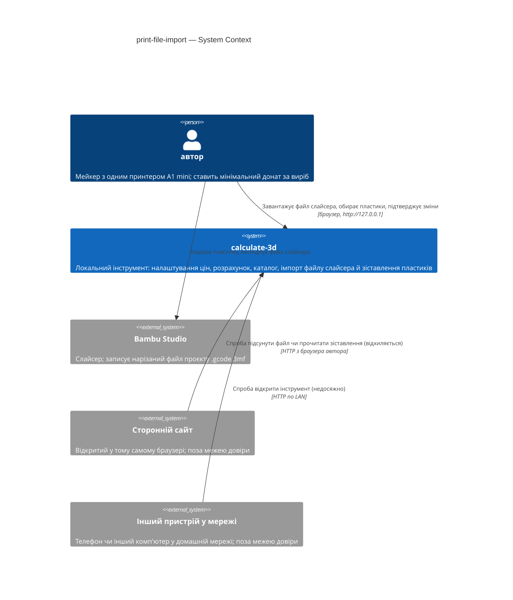
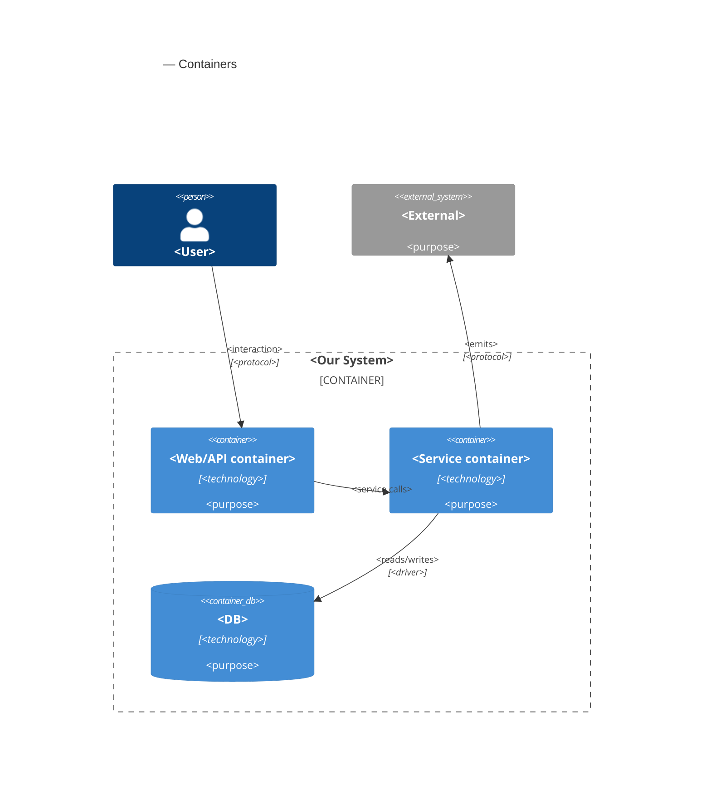
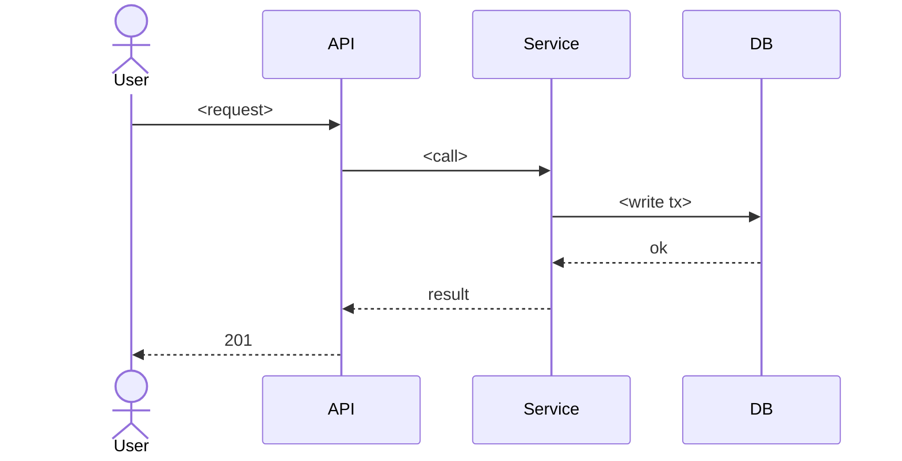

# Software Architecture Document — print-file-import

<!-- Stages 04-05 → see sdlc/plugin/skills/architecture-design/SKILL.md -->
<!-- 12 Arc42 sections. Empty sections — <!-- N/A: <one-line reason> -->. -->
<!-- C4 Context (L1) lives inline in §3. C4 Container (L2) lives inline in §5. -->
<!-- §6 Runtime view seeds the primary flow(s) here; complete-sequence-diagrams (stage 06) then -->
<!--    fills §6 with every critical flow / §5 AC — no cap. -->
<!-- Numbers in §10 come VERBATIM from PRD §6 NFR — no inventing, no rounding. -->

## 1. Introduction and goals

**Intent.** Імпорт файлу слайсера — етап 2 продукту (підхід C, PRD §1): **автор** відкриває **розрахунок** або наявний **виріб**, завантажує нарізаний файл проєкту Bambu Studio, і інструмент бере з нього витрату кожного **філамента слайсера** (разом із промивкою та вежею очищення) і час друку. Далі він підставляє запам'ятовані **зіставлення пластиків** (або один раз просить обрати пластик) і перераховує **мінімальний донат** тим самим шляхом, що й ручне введення етапу 1. Наявний виріб імпорт не змінює мовчки: до збереження видно «було → стало», а зміна застосовується лише цілком. Непридатний файл відхиляється з поясненням і пропозицією ввести дані вручну. Сам файл інструмент не зберігає — лише числа з нього (PRD §2, §3; глосарій «імпорт»).

**Top quality goals (1-liners; full scenarios in §10; порядок = пріоритет при конфлікті):**

1. **QG-1 Точність імпорту** — 100 % збіг зі слайсером на всіх еталонних файлах (грами й час за правилом AC-03 — числа файлу, округлені вгору); 0 тихих хибних імпортів.
2. **QG-2 Стійкість до поганих файлів** — 100 % пошкоджених, підроблених і «бомбових» файлів відхиляються з поясненням, без збою чи зависання інструмента; 0 байтів файлу на диску після імпорту.
3. **QG-3 Доступ лише автору** — сторонній сайт у браузері автора не може підсунути файл, прочитати чи змінити зіставлення пластиків; з іншого пристрою інструмент недоступний (AC-15).
4. **QG-4 Чуйність** — імпорт p95 ≤ 5 с для будь-якого файлу до межі розміру 100 МБ.

**Stakeholders.**

| Role | Interest | Sign-off owner? |
|---|---|---|
| автор | єдиний користувач (розрахунок, каталог, налаштування цін, тепер — імпорт і зіставлення пластиків); водночас власник продукту, архітектор і розробник навчального проєкту | Yes |

**Decision overrides.**

- Decision override: правило кількості пластин — файл відхиляється, лише коли понад одна пластина має результати нарізки; ненарізані пластини пропускаються, а інструмент показує, яку пластину імпортовано — rationale: багатоколірний еталон «LITTLE_TREES» містить 10 пластин, з яких нарізана лише одна, тож неоднозначності немає; PRD §3, AC-02, AC-13 і §8 №1 оновлено в коміті `e62935c` перед цим проходом.

## 2. Constraints

**Technical** (версії — з `backend/uv.lock` і `web/package.json` на 2026-11-09).
- Python **3.14.6** (через `uv`) · FastAPI **0.162** (Starlette 1.10) · Pydantic **2.14** · Uvicorn 0.54.
- SQLite **3.53** — один файл, `journal_mode=WAL`, `foreign_keys=ON`, кожна транзакція — `BEGIN IMMEDIATE` · SQLAlchemy **2.1** Core (без ORM) · Alembic **1.20**, міграції SQL-first (project ADR 0003).
- React **19.3** + TypeScript **5.9** + Vite **8.3** · React Router **8.5** (cost-calculator ADR 0001) · Tailwind CSS **4.3** + shadcn/ui (`web/src/shared/ui/`: button, card, input, label, table, alert-dialog, form-field, select) · TanStack Query **5.105** · `openapi-fetch` 0.17 + `openapi-typescript` (типи вебу генеруються з OpenAPI бекенду).
- Модульний моноліт router → service → repo; модулі спілкуються лише через `service.py` іншого модуля, межі перевіряє `tests/unit/test_module_boundaries.py` (project ADR 0002). Веб — Feature-Sliced Design, контроль імпортів — Steiger.
- Один процес, bind лише на `127.0.0.1`, без автентифікації (project ADR 0004); без фонових воркерів і багатопроцесних серверів (project ADR 0003).
- **Розбір файлу — лише стандартна бібліотека Python:** `zipfile`, `xml.etree.ElementTree`, `json`; нових runtime-залежностей фіча не додає. Вбудований Expat **2.8.1** захищає від експоненційного розгортання сутностей («billion laughs») з версії 2.4, а ElementTree не завантажує зовнішніх сутностей (XXE); обидва факти закріплює тест із набору поганих файлів (§10 QG-2).
- **Brownfield-факти, що обмежують імпорт:**
  - `core/guard.py` (`RequestGuard`, cost-calculator ADR 0007) відповідає `415` на кожен `POST/PUT/PATCH/DELETE` до `/api` з тілом, `Content-Type` якого не `application/json`.
  - Межі розміру тіла запиту немає ні в застосунку, ні в Uvicorn; `python-multipart` не встановлено.
  - Вхід розрахунку — `costing` `QuoteInput`: `plastics[{plastic_id, usage_cg}]` (1–32 рядки, без повтору пластику), `print_time_s` (кратний 60, від 60 до 360 000 000), `usage_cg` від 1 до 100 000 000. Ці межі — межі імпорту (PRD AC-14).
  - Таблиці `plastics` (pricing) і `items` / `item_plastics` (catalog) не мають поняття філамента слайсера чи зіставлення.

**Organisational.**
- Одна людина: автор — водночас PM, архітектор і розробник.
- Бюджет E = 2 тижні (idea-brief §11), без жорсткого дедлайну; навчальний проєкт, що проходить повний SDLC-пайплайн.
- Гейт якості перед кожним комітом і в CI — `make check` (`api-check` + `web-check` + `api-types-check`).

**Conventions.**
- Кореневий `CLAUDE.md` + `backend/CLAUDE.md` + `web/CLAUDE.md` — джерело конвенцій. `docs/architecture-map.md` описує стан до scaffold і застарів (`reflects_commit: 95f8e06`) — цей прохід спирається на свіжий скан коду (див. §11).
- IDs — UUIDv7 із застосунку (`core/ids.py::new_id()`), `TEXT` 36 символів; БД ID не генерує.
- Гроші й кількості — масштабовані цілі числа з одиницею в назві (`*_kop`, `*_cg`, `*_s`; cost-calculator ADR 0004); точні проміжні значення — `Fraction`, мінімальний донат округлюється вгору (`ROUND_CEILING`); `float` для грошей і кількостей заборонено.
- Помилки — `AppError(code, message, status)` → RFC 9457 `application/problem+json`; коди модуля — `<module>.<error_name>`; сервіси не кидають `HTTPException`.
- Міграції — `backend/migrations/versions/YYYYMMDD_HHMM_<slug>.py`, SQL-first, upgrade → downgrade → upgrade (тест); правила `.claude/rules/migrations.md` (адаптація для SQLite).
- Каталог зберігає параметри виробу, а не ціну; ціна завжди перераховується з поточних налаштувань цін.

**Regulatory / external.**
- Особистих даних немає; зіставлення пластиків — внутрішні дані на рівні налаштувань цін (PRD §6.1). Файл слайсера може містити службові дані (назви об'єктів і пластин, версію слайсера) — інструмент бере лише числа, назву, тип і колір філамента й відкидає файл.
- Security review обов'язковий (PRD §6.1): безпечне читання архіву, межа розміру, захист від запитів сторонніх сайтів. Abuse cases PRD §6.1 (сторонній сайт, інший пристрій, шкідливий архів, назва філамента як код/розмітка) покривають §8 і §10 QG-2/QG-3.
- Зовнішніх регуляторних вимог (GDPR, PCI) немає: локальний інструмент одного автора без облікових записів (project ADR 0004).

## 3. Context and scope

Автор нарізає пластину в Bambu Studio, експортує нарізаний файл проєкту й завантажує його в розрахунок або в наявний виріб; інструмент бере з файлу витрату кожного філамента слайсера та час друку, підставляє зіставлення пластиків і показує мінімальний донат (для виробу — «було → стало» до збереження) (PRD §1). Інструмент лишається однією системою на комп'ютері автора без мережевих інтеграцій: файл приходить від автора через браузер, і жодного API слайсера чи сайту моделей інструмент не викликає. Межа довіри (trust boundary — лінія, за якою дані не приймаються без перевірки) та сама, що в етапі 1, — комп'ютер автора, — але з'являється новий вид вхідних даних поза нею: **вміст файлу слайсера**. Навіть принесений самим автором, файл міг бути зібраний чужою людиною (проєкти з сайтів моделей містять чужі налаштування й вкладення — еталон «LITTLE_TREES» несе картинки й профіль автора моделі), тож кожен байт архіву вважається недовіреним, доки його не перевірено (PRD §6.1).

**External systems (in / out):**

| Actor or system | Type | Interaction |
|---|---|---|
| автор | Person | Завантажує файл слайсера в розрахунок або у виріб, обирає пластик для незіставленого філамента, підтверджує «було → стало» — через браузер на `127.0.0.1` |
| Bambu Studio | System (external) | Нарізає пластину й записує файл слайсера (`.gcode.3mf`) на диск автора; автор передає файл інструменту сам — інтеграції немає. Вміст файлу недовірений (див. вище). OrcaSlicer у цьому етапі поза обсягом (PRD §3) |
| Сторонній сайт у браузері автора | System (external, hostile) | Може спробувати підсунути файл для імпорту, прочитати чи змінити зіставлення пластиків (CSRF, DNS rebinding); запит відхиляється (AC-15) |
| Інший пристрій у домашній мережі | System (external, hostile) | Може спробувати відкрити інструмент; сервер слухає лише `127.0.0.1`, тож з мережі він недосяжний (AC-15) |

**C4 Context (L1):**



## 4. Solution strategy

**Target surface(s) (the first decision — what's being built):** `[backend-service, web-frontend]` — ті самі API й SPA, що в етапі 1: автор працює лише через браузер (PRD §4), а правила, налаштування цін і каталог живуть у бекенді. Окремий CLI PRD не просить. Поверхні успадковано від cost-calculator, тож окремого ADR немає (критерій «незворотність» не спрацьовує — нових поверхонь не з'являється).

**UI-architecture (web-frontend):** імпорт — **крок у наявних сторінках** SPA (React Router, cost-calculator ADR 0001), без нових маршрутів. Кнопка «Імпортувати файл» з'являється в розрахунку (`/calculate`) і в редакторі виробу (`/catalog/:itemId`). Новий FSD-слайс `features/slicer-import` тримає вибір файлу, список філаментів слайсера, вибір пластику, підтвердження сумування (AC-10) і панель «було → стало» (AC-05). Розібраний файл живе лише в стані форми на екрані й зникає після збереження, скасування чи перезавантаження сторінки (AC-09b). Після імпорту рядки потрапляють у ту саму форму, тож ручні правки працюють за правилами етапу 1 (AC-01, AC-05). Нове в `shared/ui` — примітив shadcn `dialog`. Рішення inline (без ADR): воно випливає з ADR 0001 етапу 1, а альтернатива (окремий екран-майстер) змусила б передавати розібраний файл між маршрутами й дублювати редактор.

**Top strategic choices (the seeds for ADRs):**

1. **Файл розбирає сервер, а зберігаються лише числа** ([ADR 0001](adr/0001-parse-slicer-file-on-server-and-keep-only-numbers.md)) — браузер надсилає файл у бекенд, і модуль імпорту розбирає його stdlib-засобами в пам'яті. Перевірки йдуть ланцюжком AC-12: проєкт Bambu Studio → нарізаний → рівно одна нарізана пластина → цілісність → межі файлу. Сервер округлює час вгору до хвилини (AC-03), нормалізує колір і назву (AC-09), підставляє запам'ятовані зіставлення пластиків і повертає результат без жодного запису в БД. Причина — QG-1 і QG-2: усі доменні правила лишаються в одному місці з розрахунком (cost-calculator ADR 0002), еталонні й погані файли тестуються в pytest, а затримку вимірюють як «час відповіді сервера» (PRD §6).
2. **Файл передається сирим тілом `application/octet-stream` і тримається лише в пам'яті під межею 100 МБ** ([ADR 0002](adr/0002-upload-slicer-file-as-raw-octet-stream-body-held-in-memory.md)) — `RequestGuard` дозволяє цей тип лише для маршруту імпорту, а всі інші змінні запити, як і раніше, приймаються лише як JSON. Тіло читається потоком і обривається на першому байті понад межу. Причина — QG-3 і QG-2: `octet-stream` не входить до «простих» CORS-типів, тож сторонній сайт не надішле його без preflight (а preflight завжди падає, бо CORS немає). Тимчасового файлу на диску (як у multipart) немає, нової залежності теж. Закриває PRD §8 №2.
3. **Зіставлення пластиків записуються в тій самій транзакції, що й виріб** ([ADR 0003](adr/0003-remember-filament-mappings-in-the-item-save-transaction.md)) — створення й оновлення виробу в `catalog` приймають необов'язковий список зіставлень (назва + колір філамента → пластик), і `catalog.service` у тій самій транзакції викликає сервіс модуля імпорту. Причина — AC-07 дослівно: вибір запам'ятовується лише разом зі збереженим виробом, а невдале збереження (наприклад, `409` на назву) не лишає зіставлень. Зіставлення вказує на пластик через FK з `ON DELETE CASCADE`, тож видалений пластик ніколи не підставляється (AC-11), і `pricing` про зіставлення нічого не знає.
4. **Рядки розрахунку складає веб із точних міліграмів** ([ADR 0004](adr/0004-compose-quote-rows-in-the-web-from-exact-milligrams.md)) — сервер повертає витрату кожного філамента цілим `usage_mg`, а чиста TS-функція в `features/slicer-import` групує філаменти за обраним пластиком, додає мг і лише потім округлює суму вгору до `usage_cg` (AC-03, AC-10). Ціну, розбивку й межі 32 пластиків / 1 000 000 г, як і раніше, рахує й перевіряє `costing` на сервері (AC-14 — «так само, як при ручному введенні»). Причина — QG-1 без додаткового запиту на кожну зміну вибору: сервер без стану однаково не має файлу, щоб перевірити повернені браузером філаменти.

Тактичні рішення в §5–§8 мають випливати з цих чотирьох; суперечність — червоний прапорець для §11.

## 5. Building block view

<!-- 🎯 Навіщо: ВНУТРІШНЯ ДЕКОМПОЗИЦІЯ — модулі, контейнери, БД. Статична топологія:   -->
<!--           хто з ким може говорити. Без §5 §6 (сценарії) не має словника учасників. -->
<!-- 📋 Що писати: 1 абзац про стиль (шари/гексагональна/clean/на подіях) +            -->
<!--           дерево папок + Mermaid C4Container.                                       -->
<!-- 📌 ОДИН Container на кожну оголошену target_surface (frontmatter): fullstack        -->
<!--           [backend-service, web-frontend] = backend-API container + web/SPA container; -->
<!--           [backend-service, mobile-app] = API + mobile app. Container(web, …) нижче — -->
<!--           лише приклад однієї поверхні; додай/заміни під оголошене у §4. → _shared/surfaces.md -->
<!-- 📌 Приклад: «web-app, content-api, media-worker, postgres, s3, cdn».                -->

<One paragraph: layered / hexagonal / clean / event-driven. Why.>

**Internal decomposition:**

```
<e.g. internal/modules/goals/>
├── domain/       <entities + sentinel errors>
├── app/          <use cases / services>
├── infra/        <repository + outbox impl>
├── ports/        <HTTP handlers, DTOs, error mapping>
└── module.go     <self-wiring>
```

**C4 Container (L2):**



## 6. Runtime view

<!-- 🎯 Навіщо: ПОТІК У RUNTIME для 1-2 критичних сценаріїв. Хто з ким коли і у якому     -->
<!--           порядку говорить. Без §6 §5 — лише купа коробок без життя.                  -->
<!-- 📋 Що писати: Mermaid sequenceDiagram. Учасники — імена з §5 (не вигадуй нові!).      -->
<!--           Повідомлення семантичні («складає чорновик»), БЕЗ HTTP-методів/шляхів —     -->
<!--           ендпоінт-рівневі sequence-діаграми зʼявляться у stage 06 (api-forge).        -->
<!-- ⏳ RESERVED FOR SEQUENCES: architecture-design сіє лише primary flow(s) тут.          -->
<!--           complete-sequence-diagrams (stage 06) ДОПОВНЮЄ §6 кожним критичним flow /    -->
<!--           кожним §5 AC — без обмеження. Не намагайся покрити все тут.                  -->
<!-- 📌 Приклад: «methodist → web-app: складає чорновик → web-app → content-api: зберегти». -->

**Critical flow 1: <flow name>**



<!-- For XS/S: 1 flow above is enough. For M+: add 2-4 more (e.g. failure-mode flow, async flow). -->

**Critical flow 2: <e.g. async event propagation>** — <if applicable, otherwise N/A>.

## 7. Deployment view

<!-- 🎯 Навіщо: ТОПОЛОГІЯ, яку DevOps має знати без читання Helm-чартів — скільки реплік,  -->
<!--           де живе фоновий обробник, ПРИ ЯКИХ ЧИСЛАХ масштабуємось.                     -->
<!-- 📋 Що писати: 2-3 речення про топологію + метрики + алерти + конкретні числа-пороги.   -->
<!-- 📌 Приклад: «500 IC → партиціонування за кварталом» (не «при зростанні подумаємо»).    -->
<!-- 🎯 Можна N/A для XS/S функцій, що переюзають існуюче розгортання без змін.            -->

<Topology in 2-3 sentences. Where it runs (k8s / VM / serverless), replicas, scaling thresholds.>

**Monitoring:**
- <Metrics — e.g. Prometheus `<metric_name>`>
- <Alerts — e.g. "outbox lag > 10 min → page on-call">
- <Tracing — e.g. OpenTelemetry HTTP spans>

**Scaling thresholds:**
- <e.g. 500 IC × 5 goals × 26 checkpoints/Q = 65k rows/year — comfortable in one table>
- <e.g. partitioning by quarter at >500k rows/year>

<!-- For XS/S that doesn't change deployment: <!-- N/A: feature reuses existing deployment unit -->. -->

## 8. Crosscutting concepts

<!-- 🎯 Навіщо: НАСКРІЗНІ ПАТЕРНИ, які перетинають кілька модулів: логування, помилки,    -->
<!--           авторизація, ID strategy, outbox, кеш. ⭐ Друга найгустіша секція.          -->
<!--           Якщо патерн всередині одного модуля — він НЕ сюди. Якщо це конвенція        -->
<!--           проєкту в цілому — у CLAUDE.md.                                              -->
<!-- 📋 Що писати: таблиця концепт / конвенція / де визначено. Один рядок на концепт.      -->
<!-- 📌 Приклад: «UUID v7 (час+випадковий, сортується) у app-layer» — як default з CLAUDE.md. -->

| Concept | Convention | Where defined |
|---|---|---|
| Logging | <e.g. structured slog, fields `module=<name>`> | <CLAUDE.md §X or here> |
| Authentication | <e.g. JWT via session middleware> | <CLAUDE.md §X> |
| Error handling | <e.g. domain sentinel → ports/errors.go → apperr JSON> | <CLAUDE.md §X> |
| ID strategy | <e.g. UUID v7 in app layer> | <CLAUDE.md §X> |
| Internationalisation | <e.g. N/A, English only> | — |
| Observability | <e.g. OpenTelemetry on HTTP boundaries> | — |
| Outbox / events | <module-specific patterns, if any> | <here> |

## 9. Architecture decisions

<!-- 🎯 Навіщо: ЗВОРОТНИЙ ІНДЕКС на папку adr/. `ls adr/` дає файли, §9 дає семантику —    -->
<!--           чому вони існують, до якого зрізу SAD привʼязані, у якому статусі.           -->
<!-- 📋 Що писати: таблиця з 4 колонками. Один рядок на ADR. Mixed status — це OK.         -->
<!-- 📌 Приклад: «0001 | Зберігати урок як таблицю блоків | Accepted | §4».                -->

| # | Title | Status | Section |
|---|---|---|---|
| <NNNN> | <imperative — e.g. "Use sliding window for rate limiting"> | Accepted | §<N> |
| <NNNN> | <imperative — e.g. "Co-locate outbox worker in API process"> | Accepted | §<N> |

ADR files live under `docs/features/<slug>/adr/NNNN-<title>.md`.

## 10. Quality requirements

<!-- 🎯 Навіщо: ДЕРЕВО ЯКОСТЕЙ (Quality Tree) — беремо мету з §1 і розкладаємо на          -->
<!--           конкретні листя: тести, метрики, конфіги, drill-и. ⭐ Без §10 §1 — це       -->
<!--           маніфест. З §10 кожна декларація мапиться на щось, ЩО МОЖНА ДОВЕСТИ.        -->
<!-- 📋 Що писати: на кожну якість з §1 — When / Then / How verify. Числа з PRD §6 NFR     -->
<!--           ДОСЛІВНО (не округлюй p95 ≤250мс до ≤300мс — це F6-помилка критика).        -->
<!-- 📌 Приклад: «p95 ≤500 мс на UPDATE блоку, перевіримо k6 load test 100 req/s».        -->

Each top-3 goal from §1 expanded into a full scenario:

**QG-1. <quality attribute>**
- **When:** <trigger condition>
- **Then:** <expected behavior with numbers from PRD NFR>
- **How verify:** <test / chaos drill / load test / observability>

**QG-2. <quality attribute>**
- **When:** <trigger>
- **Then:** <expected>
- **How verify:** <how>

**QG-3. <quality attribute>**
- **When:** <trigger>
- **Then:** <expected>
- **How verify:** <how>

## 11. Risks and technical debt

<!-- 🎯 Навіщо: ⭐ збирає ВСЕ, що може зламатись — і не лише технічне. Без §11 ризики   -->
<!--           обговорюються на стендапах і губляться; борг лишається у голові того,    -->
<!--           хто його прийняв.                                                          -->
<!-- 📋 Що писати: таблиця ризик/борг — серйозність — мітигація — власник. Технічний    -->
<!--           борг окремою секцією.                                                      -->
<!-- 📌 Приклад: «EM не пушить — member не оновлює дані | High | …». Перший ризик —      -->
<!--           часто продуктовий, не технічний. Це нормально.                            -->

<!-- Severity column literals: Low / Medium / High for regular risks; "Open question" for rows
     created by Step-7 `Save as Open Question` resolutions (see references/socratic-loop.md). -->

| Risk / debt | Severity | Mitigation | Owner |
|---|---|---|---|
| <e.g. Outbox lag may reach hours during downstream outage> | Medium | <Alert >10 min, on-call playbook, retry backoff> | <DevOps> |
| <e.g. No event schema versioning in v1> | Medium | <ADR-NNNN planned for v2, graceful handling of unknown fields> | <Backend> |
| Open architectural decision: <decision-headline> | Open question | Resolve before <stage trigger or YYYY-MM-DD>; <inline rationale from Step-7 Save-as-OQ> | <owner> |

**Accepted debt (acceptable in v1, plan to fix later):**
- <e.g. Goal entity is not versioned (immutable) — OK for v1, may need audit versioning in v2>

## 12. Glossary

<!-- 🎯 Навіщо: ⭐ СЛОВНИК ДОМЕНУ, який припиняє суперечки через рік («checkpoint —      -->
<!--           weekly чи biweekly? Quarter — календарний чи фіскальний?»).                -->
<!-- 📋 Що писати: таблиця термін / значення. Бізнес-терміни + технічні вперемішку.       -->
<!--           Один термін може мати дві мови у заголовку: «Goal (Обʼєктив)».              -->
<!-- 📌 Приклад: «Lesson | урок усередині курсу, що складається з блоків (text, video)». -->

| Term | Meaning |
|---|---|
| <e.g. Goal> | <quarterly intent in statement form> |
| <e.g. KR> | <Key Result — measurable target linked to a Goal> |
| <e.g. Checkpoint> | <bi-weekly progress update on a KR> |
