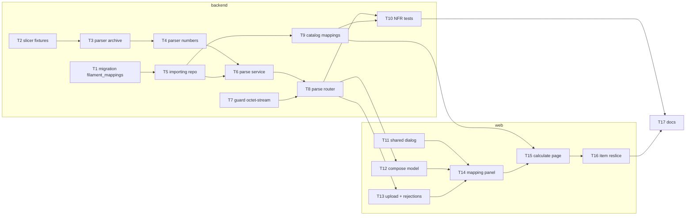

# Epic — print-file-import

> **PRD:** [PRD.md](../PRD.md) · **Design:** [sad.md](../sad.md) · **Data model:** [data-model.md](../data-model.md) · **API:** [openapi.yaml](../contracts/openapi.yaml) · **ADRs:** [adr/](../adr/)

## Goal

Після цього епіку мінімальний донат нового або перенарізаного виробу спирається на числа нарізаного файлу Bambu Studio без ручного переписування; повторні імпорти підставляють запам'ятовані зіставлення пластиків, а наявний виріб ніколи не змінюється мовчки — спершу «було → стало», а непридатний файл відхиляється з поясненням ([PRD §2](../PRD.md)).

## Scope

- **In:** `target_surfaces: [backend-service, web-frontend]` ([sad.md](../sad.md) frontmatter). Backend: 1 міграція (`filament_mappings`), новий модуль `importing` (parser · repo · service · router; [ADR 0005](../adr/0005-add-an-importing-module-that-owns-the-parser-and-filament-mappings.md)), виняток `octet-stream` у `core/guard.py` ([ADR 0002](../adr/0002-upload-slicer-file-as-raw-octet-stream-body-held-in-memory.md)), `catalog` приймає `filament_mappings` у транзакції збереження ([ADR 0003](../adr/0003-remember-filament-mappings-in-the-item-save-transaction.md)). Web: новий FSD-слайс `features/slicer-import` (складання рядків із мг — [ADR 0004](../adr/0004-compose-quote-rows-in-the-web-from-exact-milligrams.md)), `shared/ui/dialog`, вбудовування в сторінки `calculate` і `item` без нових маршрутів.
- **Out:** кілька нарізаних пластин в одному файлі, файли OrcaSlicer та інших слайсерів, зберігання самого файлу, історія параметрів виробу, зміна формули собівартості, окремий перегляд чи редагування зіставлень ([PRD §3](../PRD.md)).

## Task map

Чотири задачі стартують одночасно: міграція (T1), фікстури слайсера (T2), захист запитів (T7) і веб-примітив `dialog` (T11). Backend-гілка сходиться на роутері T8, який перегенеровує `schema.d.ts`, — від нього залежить уся веб-гілка, бо API-типи у вебі вручну не пишуться.

**Смуги серіалізації (`implement-tasks`):** T1 — `migration`; T3 → T4 (`parser.py`); T5 → T6 (`importing/service.py`); T8 і T9 (`web/src/shared/api/schema.d.ts`); T15 → T16 (`features/save-item`). Критичний шлях: T2 → T3 → T4 → T6 → T8 → T13 → T14 → T15 → T16 → T17.

## Tasks

See [tracker.md](./tracker.md) for status. Machine contract: [tasks.json](./tasks.json).

| # | Task | Layer | Blocked by | DoD (short) |
|---|---|---|---|---|
| [T1](./T1-promote-filament-mappings-migration.md) | Промоутнути staged-міграцію filament_mappings і дзеркало importing/tables.py | migration | — | Ревізія create_filament_mappings проходить upgrade → downgrade → upgrade у test_migrations, а видалення пластику каскадно видаляє його рядок filament_mappings. |
| [T2](./T2-slicer-fixtures-and-bad-file-generator.md) | Скопіювати еталонні файли слайсера у фікстури й написати генератор поганих файлів | tests | — | backend/tests/fixtures/slicer/ містить три еталони, а bad_files.py будує в пам'яті кожен випадок переліку SAD §10 QG-2 з очікуваним кодом importing.* і самоперевіркою, що кожен випадок генерується. |
| [T3](./T3-parser-archive-limits-and-plate-chain.md) | Парсер: межі читання архіву й ланцюжок «проєкт Bambu → нарізаний → одна пластина» | domain | T2 | Юніт-тести парсера показують: не-ZIP і CAD-3MF/OrcaSlicer → not_slicer_project, vtulka_A.3mf → not_sliced, дві нарізані пластини → multiple_sliced_plates, кожне порушення меж архіву → corrupted_file, а LITTLE_TREES дає пластину 1 «mini christmas tree». |
| [T4](./T4-parser-numbers-normalization-and-merge.md) | Парсер: числа, нормалізація філамента, злиття однакових пар і межі файлу | domain | T3 | Юніт-тести парсера дають для vtulka_A 11 540 мг і 5 880 с, для LITTLE_TREES 15 490 / 2 230 / 2 360 мг і 5 460 с без коричневого, і очікувані коди для кожного числового поганого випадку T2. |
| [T5](./T5-importing-repo-and-remember-mappings.md) | importing.repo: пошук зіставлень за (назва, колір) і upsert; remember_mappings у service | infra | T1 | Інтеграційні тести repo показують: пошук до 32 пар повертає plastic_id лише для збережених пар, upsert замінює plastic_id і зберігає id/created_at, а FK-порушення стає repo-винятком, який remember_mappings мапить на доменну помилку. |
| [T6](./T6-importing-service-parse-slicer-file.md) | importing.service.parse_slicer_file: готовність налаштувань, розбір, підстановка зіставлень, помилки | app | T4, T5 | Юніт-тести service показують: без пластиків чи налаштувань — ImportSettingsMissing з переліком missing до розбору, кожен ParseError — свій AppError importing.* з українським повідомленням, а підставлений plastic_id береться лише з наявного зіставлення (інакше null). |
| [T7](./T7-request-guard-octet-stream-exception.md) | RequestGuard: приймати application/octet-stream лише для POST /api/importing/parse | wiring | — | Інтеграційні тести захисту показують 415 для multipart/form-data і text/plain на маршруті імпорту та для octet-stream на будь-якому іншому змінному /api-маршруті, а перевірки Host/Origin/Sec-Fetch-Site діють на маршруті імпорту без змін. |
| [T8](./T8-importing-parse-router.md) | Роутер POST /api/importing/parse: потокове читання під межею 100 МБ, problem+json, api-types | ports | T6, T7 | Інтеграційні тести показують, що parseSlicerFile повертає контрактний SlicerFile для обох нарізаних еталонів, 413 importing.file_too_large для 100 000 001 байт, очікуваний код для кожного випадку bad_files без 500, 0 нових файлів на диску, а make api-types-check зелений. |
| [T9](./T9-catalog-save-item-with-mappings.md) | catalog: ItemInput.filament_mappings і remember_mappings у транзакції збереження виробу | app | T5 | Інтеграційні тести catalog показують, що createItem/updateItem із filament_mappings зберігають виріб і зіставлення разом, а 409 catalog.name_taken чи 422 importing.plastic_not_found не лишають ні виробу, ні змін виробу, ні жодного зіставлення. |
| [T10](./T10-importing-nfr-and-reference-tests.md) | NFR і еталонні тести імпорту: точність донату, латентність 100 МБ, збереженість, перенарізка | tests | T8, T9 | Інтеграційні тести показують донат 18,82 ₴ для vtulka_A і 22,00 ₴ після зміни ціни, 60,73 ₴ після перенарізки «Підставки», p95 ≤ 5 с для еталонів і файлу рівно 100 000 000 байт, а зіставлення переживає перезапуск застосунку й забувається після видалення пластику. |
| [T11](./T11-shared-ui-dialog.md) | Додати shadcn-примітив dialog у shared/ui | ui | — | shared/ui експортує Dialog, а Vitest-тест показує, що він відкривається, має доступну назву й закривається Escape. |
| [T12](./T12-slicer-import-compose-model.md) | features/slicer-import/model: compose.ts — рядки з точних мг, конфлікти сумування, diff «було → стало» | domain | T8 | Vitest compose.test.ts показує 11 543 мг → 1 155 сг, 2 001 + 2 001 мг → 401 сг, незіставлений філамент блокує результат, дві різні пари на один пластик без підтвердження дають конфлікт, а diff «Підставки» дає 80 → 95 г, PETG прибрано, 2:00 → 2:15. |
| [T13](./T13-slicer-import-upload-and-rejections.md) | features/slicer-import: кнопка «Імпортувати файл», мутація розбору й повідомлення відмов | ui | T8 | Vitest-тести показують, що вибір файлу надсилає його сирим тілом application/octet-stream, а кожен код importing.* і 409 settings_missing дає своє українське пояснення з пропозицією ввести дані вручну (і посиланням на налаштування для AC-04). |
| [T14](./T14-slicer-import-filament-mapping-panel.md) | features/slicer-import: список філаментів, вибір пластику, підтвердження сумування | ui | T11, T12, T13 | Vitest-тести панелі показують філамент як у слайсері (назва, тип, зразок кольору, грами) з Select пластику, блок доната до вибору кожного пластику, пояснення AC-09b за порожніх пластиків, діалог сумування для двох різних пар на один пластик і номер та назву імпортованої пластини. |
| [T15](./T15-calculate-page-import-and-save-mappings.md) | Сторінка розрахунку: імпорт у форму і передача зіставлень під час збереження виробу | ui | T9, T14 | Vitest-тест CalculatePage показує, що імпорт vtulka_A замінює всі рядки й час (1 год 38 хв), показує донат з quoteCost, ручна правка після імпорту працює, а збереження виробу надсилає filament_mappings з вибором кожного філамента; без збереження зіставлення не надсилаються. |
| [T16](./T16-item-page-reslice-was-became.md) | Сторінка виробу: імпорт перенарізки з «було → стало», підтвердженням і скасуванням | ui | T15 | Vitest-тест ItemPage показує для «Підставки» «було → стало» 80 → 95 г, PETG прибрано, 2:00 → 2:15, 80,63 → 60,73 ₴ з «було» зі свіжого getItem, перерахунок «стало» після ручної правки, а скасування чи відмова файлу не надсилає updateItem. |
| [T17](./T17-docs-mg-suffix-and-contract-reconcile.md) | Документація: суфікс *_mg у CLAUDE.md, закриття D1/D3 у api-sync-report | docs | T10, T16 | CLAUDE.md § Money/units називає суфікс *_mg (лише у відповіді розбору), api-sync-report.md позначає D1 і D3 закритими з посиланням на тести T6/T8, а make check зелений. |

**Total:** 17 tasks, ~8.5 person-days (S = 2 год, M = пів дня, L = день) — у межах бюджету E = 2 тижні (idea-brief §11). Owner усіх задач — Anton Pohorielov.

## Risks / Hard rules

- **Модулі лише через `service.py`** (project ADR 0002): `catalog → importing.service.remember_mappings`, `importing → pricing.service`; `test_module_boundaries` має лишатися зеленим (T5, T6, T9).
- **Розбір — лише stdlib, без запису на диск** ([sad.md](../sad.md) §2, §8; PRD §6 «Файл не зберігається»): жодної нової Python-залежності, жодного `tempfile`, G-code не розпаковується (T3, T4, T8).
- **Межі безпеки архіву перед порядком AC-12** ([sad.md](../sad.md) §8): ≤ 10 000 записів, ≤ 8 000 000 байт на частину за заголовком і фактичним читанням (T3).
- **Округлення лише вгору, без `float`** (cost-calculator ADR 0004): `Decimal` з рядка в парсері, точні `usage_mg`, сума → `ceil` до сг у вебі (T4, T12); бекенд-тест T10 і `compose.test.ts` T12 — на тих самих прикладах (accepted debt [sad.md](../sad.md) §11).
- **Виняток `octet-stream` — точний маршрут і метод** ([ADR 0002](../adr/0002-upload-slicer-file-as-raw-octet-stream-body-held-in-memory.md), [sad.md](../sad.md) §11): решта змінних `/api` — лише JSON (T7).
- **Зіставлення — лише в транзакції збереження виробу** ([ADR 0003](../adr/0003-remember-filament-mappings-in-the-item-save-transaction.md)): розбір нічого не пише; невдале збереження не лишає зіставлень (T6, T9).
- **API-типи вебу — лише з `make api-types`**; кожна зміна схеми бекенду комітиться разом з `schema.d.ts` (T8, T9).
- **FSD**: `features/slicer-import` не імпортує `features/quote-form` / `save-item` — їх з'єднують сторінки (T12, T13, T15); назви з файлу — лише текст, без `dangerouslySetInnerHTML` (T14).
- **Межі рядків (32 пластики / 1 000 000 г) перевіряє `costing`**, а не парсер чи веб (AC-14; T4, T12, T15).
